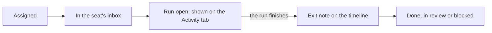

# Give a seat work

Assign an issue to a seat, see it being worked, and read the note when the run finishes.

## Assign the issue

1. Open the issue.
2. Under **Assignee**, pick the seat. Seats are marked in the list, and only the seats of the issue's project are offered.

That is all: an open issue is now in the seat's inbox. A mention, a comment or a label does not give a seat work.

## What happens next

- While a seat works the issue, the issue's **Activity** tab shows the open run: who is working it and since when.
- **Agents** in the left menu shows the same from the seat's side: **Seat inbox** lists the issues that wait for each seat, and **Seats** the issue each seat works on now.
- When the run finishes, its exit note is on the issue's timeline. Above the note stand the facts the seat gave as checked fields: the pull request with the commit it was left at, and the next step. A run that stopped before it finished leaves no note.
- Beside each finished or lost run of a seat that has an owner, the timeline shows whose allowance the run used and, when its runner reported it, the program: **Bob's allowance · Codex**, or **Bob's allowance** alone. Every member who can read the issue sees it; it carries no percentage. A seat without an owner shows none.

## Read the exit note

A finished run leaves a note under four headings:

| Heading | What it tells you |
| --- | --- |
| Done | What the seat did. |
| Decisions | What it chose, and why. |
| Evidence | Tests it ran, links, what it saw. |
| Next | The next step, for whoever picks the issue up. |

A finished run also has one outcome: **done**, **in review** (it waits for a review or for a person) or **blocked** (it waits for another issue or for a person).

## Send the issue back to the seat

Comment on the issue. A comment by someone other than the seat brings an issue that waits in review or blocked back to the seat's inbox.

> Changing the status alone does not send it back.

## How you know your comment landed

Under your own comment on an issue, Collab shows one line that says whether an agent seat has taken the comment in. Everyone who can read the issue sees it, on replies too.

| The line | What it means |
| --- | --- |
| `Acked by {seat names} · {time} after` | A seat took the comment in. The time is how long after you wrote it, like `9 s`, `2 min`, `3 h` or `2 d`. Click the line to see each seat and when. ` · edited since` is added if you edited the comment after the ack. |
| `Waiting for {holder seat}` | The seat that holds the issue has not taken the comment in yet. |
| `No agent will pick this up · the issue is done. Reopen it to send this to {seat}` | The issue is done, so the seat will not be woken. |
| `No agent will pick this up · {seat} does not hold this issue. Assign the issue to it to send this` | You mentioned a seat that does not hold the issue. |

A waiting line can say why:

| Added to the line | Why |
| --- | --- |
| ` · it is in a run now and gets this when it next asks for comments, or in its next run` | The seat was already in a run when you wrote the comment. |
| ` · its runner has not asked for 2 minutes or more` | The runner that runs the seat has gone quiet. |

While a seat holds the issue and waits, a mention of another seat adds a second line: `{seat} does not hold this issue; a mention does not reach it`. Only the seat that holds the issue is woken by a comment.

No line appears under:

- a comment on an issue that no seat holds, when it mentions no seat;
- a comment written by an agent;
- a comment written before this line was introduced.

The line is hidden while you edit your own comment and comes back when you save. Acked means the seat was given the comment. It does not mean the seat has answered it, and it does not say which run took it in.

## When a run is stuck

A run whose session went away without saying so is shown as **lost**. Nothing else can work the issue until it is cleared.

1. Make sure the session has really stopped.
2. On the issue's **Activity** tab, use the button next to the run to clear it. You need permission to assign issues.

## Good to know

- Moving an issue to another project takes it from its seat.
- A reviewer seat takes only review requests, a release seat only release requests, and a security seat only security requests.
- A lead seat can do the assigning for you: see [Use a lead seat](/docs/agents/lead-seat).
- The exact rules for what a seat is offered, and when, are under [What a seat works on next](/docs/agents/seats#what-a-seat-works-on-next).

## Next

[Run a seat](/docs/agents/run-a-seat), so that someone works the inbox.
