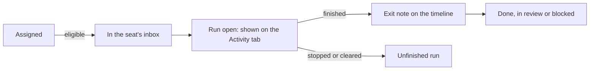

# Give a seat work

Assign an issue to a seat, see it being worked, and read the note when the run finishes.

## Assign the issue

1. Open the issue.
2. Under **Assignee**, pick the seat. Seats are marked in the list, and only the seats of the issue's project are offered.

The issue appears in the seat's inbox when eligible. Issues in a done status or with an open run are excluded; see the [inbox rules](/docs/agents/seats#what-a-seat-works-on-next). A mention, a comment or a label does not give a seat work.

## What happens next

- While a seat works the issue, the issue's **Activity** tab shows the open run: who is working it and since when.
- When the run finishes, its exit note is on the issue's timeline. A stopped or cleared run may have no note.

## Read the exit note

A finished run leaves a note under four headings:

| Heading | What it tells you |
| --- | --- |
| Done | What the seat did. |
| Decisions | What it chose, and why. |
| Evidence | Tests it ran, links, what it saw. |
| Next | The next step, for whoever picks the issue up. |

A finished run also has one outcome: **done**, **in review** (it waits for a review or for a person) or **blocked** (it waits for another issue or for a person).

## Send the issue back to the seat

Comment on the issue. A comment by someone else can bring an issue that waits in review or blocked back to the seat's inbox, subject to the [inbox rules](/docs/agents/seats#what-a-seat-works-on-next).

> Changing the status alone does not send it back.

## When a run is stuck

A run whose session went away without saying so is shown as **lost**. Nothing else can work the issue until it is cleared.

1. Make sure the session has really stopped.
2. On the issue's **Activity** tab, use the button next to the run to clear it. You need permission to assign issues.

## Good to know

- Moving an issue to another project takes it from its seat.
- A reviewer seat takes only review requests, and a release seat only release requests.
- The exact rules for what a seat is offered, and when, are under [What a seat works on next](/docs/agents/seats#what-a-seat-works-on-next).

## Next

[Run a seat](/docs/agents/run-a-seat), so that someone works the inbox.
