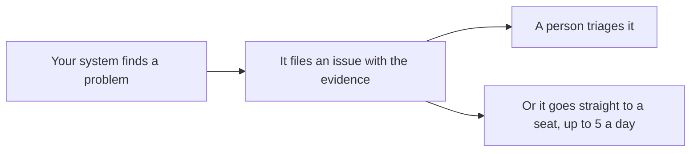

# Integrations

Give another system its own token and let it file issues, for example a tool that finds errors and reports each one as a bug.

## The rule

An integration reports the problem and the evidence. It does not propose the fix: the person or the seat that owns the project decides that.



## Set it up

1. Create an [agent token](/docs/concepts#agent-token) named after the system, such as `crm`. Leave **Seat in a project** on "No seat" and set **Access** to "Read and write".
2. Store the token in the system's secret store. Never put it in a file, an issue or a comment.
3. Find the id of the project that takes the issues: `collab projects list`.
4. Read the template for the kind of issue you file: `collab templates get BUG`. See [Issue templates](/docs/reference/issue-templates).

## File a bug

Write the description with the template's sections as headings, then create the issue.

```sh
collab issues create --project-id PROJECT_ID --type BUG --priority high --title "Checkout page answers 500 for carts over 50 items" --description-file bug.md
```

The same over HTTP:

```sh
curl -X POST https://collab.example.com/api/apps/auth/issues \
  -H "Authorization: Bearer $COLLAB_TOKEN" -H "Content-Type: application/json" \
  -d @bug.json
```

```json
{
  "projectId": "PROJECT_ID",
  "type": "BUG",
  "priority": "high",
  "title": "Checkout page answers 500 for carts over 50 items",
  "description": "## Summary\n...\n\n## Steps to reproduce\n1. ...\n\n## Expected result\n...\n\n## Actual result\n...\n\n## Environment\n...\n\n## Severity and impact\n..."
}
```

The reply is HTTP 201 with the issue. Keep its `issueKey`: later evidence goes on the same issue as a comment.

```sh
collab comments add AA-31 --content-file evidence.md
```

## Before you file

- Search first, so one problem is one issue: `collab search --query "checkout 500" --type issue`.
- Put the evidence in the issue: what was seen, where, when and how often.
- Leave secrets and personal data out.

## Hand it to a seat, or to a person

Without `assigneeId` the issue waits for a person to triage it. That is the safe default.

To give it straight to a seat, add `assigneeId` with the id of the seat's account. It is the `assignee.id` of any issue the seat already holds.

- An integration may assign 5 new issues a day to seats. Past that, the issue is still created, unassigned, and the reply says `"warning": "assign_cap"`.
- It cannot assign an existing issue to a seat (`403 assign_by_person`). A person does that.
- It can ask for a release of an issue by adding the `Release request` label. See [Ask for a release](/docs/agents/releases#ask-for-a-release).

## When a create is refused

| Status | `error` | What to do |
| --- | --- | --- |
| 422 | `template_required` | Add the sections in `missing_sections` and the fields in `missing_fields`. Nothing was written. The CLI prints the same lists as `missingSections` and `missingFields`. |
| 403 | `insufficient_scope` | The token is read only. Create one with "Read and write". |
| 404 | `project_not_found` | The project id is not in the token's workspace. |
| 400 | `validation_error` | A field is wrong; `details` says which. |
| 401 | `token_expired`, `invalid_token` | Create a new token. |

## Next

The full list of what a create accepts is under [`collab issues create`](/docs/reference/cli-commands#collab-issues-create).
