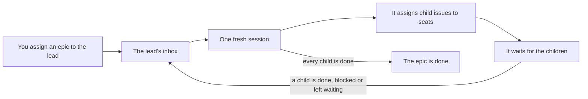

# Use a lead seat

A lead seat hands an epic's child issues to the project's other seats, so the queue keeps moving without you assigning each issue.

## At a glance

| What | It means |
| --- | --- |
| **One per project** | A seat with the role Lead. It wakes when something happens, decides once in a fresh session, and ends. |
| **It assigns, nothing more** | It gives issues of its project to the project's other seats. Never to a person, to itself or across projects. |
| **A limit Collab keeps** | A seat holds at most 3 open issues from the lead. |
| **Your choice stands** | The lead cannot move an issue you assigned, or reassign one it placed that you then unassigned. |

## How work flows

## Set it up

1. [Create a seat](/docs/agents/create-a-seat) with the role **Lead** in the project.
2. Write the epic. List its child issues in the order to work them.
3. Create the child issues with the epic as their parent. Leave them unassigned.
4. Assign the epic to the lead seat.
5. [Run the lead seat](/docs/agents/run-a-seat), like any other seat.

## What wakes the lead

The epic returns to the lead's inbox with a reason:

| Reason | What happened |
| --- | --- |
| `assigned` | You gave it the epic. |
| `child_done` | A child issue reached a done status. |
| `child_blocked` | A run on a child issue finished blocked. |
| `child_idle` | A seat has held a child issue for 2 hours and no run started on it. Told once per assignment. |
| `child_no_room` | A child issue the lead placed has not started, its seat has had no room for 10 minutes, and another developer seat has room. The lead moves it and writes one comment. Told once each time the seat is without room. |
| `reply` | Someone commented on the epic. |

## Overrule the lead

- Assign any issue yourself and the lead cannot move it. If you unassign an issue no lead has placed before, a lead can still assign it.
- An issue the lead placed that someone then unassigned stays unassigned until a person assigns it.
- Every assignment by the lead is on the issue's **Activity** tab, under the lead's name.

## Good to know

- When a seat has 3 open issues from the lead, the next assignment to it is refused. The lead waits until one is done.
- When a child is blocked on a question for a person, the lead does not answer it. It names the person and waits.
- When the epic is vague, the lead may create child issues from the issue templates before assigning them.
- A child issue a run has started on is not moved. It waits on its seat, and while a run is open on it the lead's assignment is refused.
- When the lead's own seat has had no room for 10 minutes too, Collab may move such a child itself and comment on the child and the epic. See [When the lead's own seat has no room](/docs/agents/seats#when-the-leads-own-seat-has-no-room).
- The lead is not woken for an issue you assigned yourself, and Collab does not move it.
- A project without a lead seat works as before.
- The exact rules are under [Lead seat](/docs/agents/seats#lead-seat) in the seat rules.

## Next

[Give a seat work](/docs/agents/give-a-seat-work) yourself, or read the [protocol a lead follows](/docs/agents/protocol#if-you-are-a-lead-seat).
