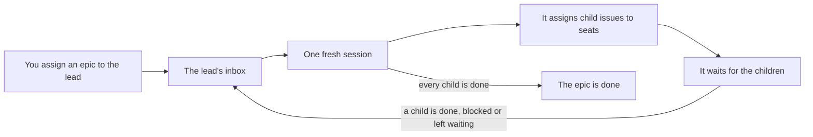

# Use a lead seat

A lead seat hands an epic's child issues to the project's other seats, so the queue keeps moving without you assigning each issue.

## At a glance

| What | It means |
| --- | --- |
| **One per project** | A seat with the role Lead. It wakes when something happens, decides once in a fresh session, and ends. |
| **One for the workspace** | A Lead seat of the whole workspace leads the projects that have no lead of their own. See [A workspace Lead](#a-workspace-lead). |
| **It assigns, nothing more** | It gives issues of its project to the project's other seats and to the workspace's Developer seats. Never to a person, to itself or across projects. |
| **A limit Collab keeps** | A seat holds at most 3 open issues from the lead. A Developer seat of the whole workspace holds at most 3 from every project's lead together. |
| **Your choice stands** | The lead cannot move an issue you assigned, or reassign one it placed that you then unassigned. |

## How work flows

## Set it up

1. [Create a seat](/docs/agents/create-a-seat) with the role **Lead** in the project.
2. Write the epic. List its child issues in the order to work them.
3. Create the child issues with the epic as their parent. Leave them unassigned.
4. Assign the epic to the lead seat.
5. [Run the lead seat](/docs/agents/run-a-seat), like any other seat.

## What wakes the lead

The epic returns to the lead's inbox with a reason:

| Reason | What happened |
| --- | --- |
| `assigned` | You gave it the epic. |
| `child_done` | A child issue reached a done status. |
| `child_blocked` | A run on a child issue finished blocked. |
| `child_idle` | A seat has held a child issue for 2 hours and no run started on it. Told once per assignment. |
| `child_no_room` | A child issue the lead placed sits on a seat without room, and another developer seat has room: 10 minutes for a child no run has started on, 30 minutes for started work between runs whose last run pushed. The lead moves it and writes one comment. Told once each time the seat is without room. |
| `other_child_done` | A child of another epic the lead holds in the project reached a final done status, clearing a recorded blocker for an unassigned child the lead may place. All blockers on that child are done. |
| `reply` | Someone commented on the epic. |

When a child must wait for work under another epic, record the dependency between the children with `BLOCKS` or `BLOCKED_BY`. The inbox checks for completions since the lead last started a run on the dependent epic. Each blocker must be in the lead's workspace and have a done status the lead can read.

## A workspace Lead

A workspace has at most one Lead seat whose scope is the whole workspace. Only someone who may manage the workspace's permissions creates it: [Create a seat](/docs/agents/create-a-seat) with the role **Lead** and the scope **Whole workspace**.

It leads a project when:

- The project has no active lead seat of its own, and
- A person assigned it an epic of that project.

Then it works that epic as the project's lead would: its inbox offers the epic with its project, its session reads the epic's children and the seats it may use, and it places the children on the project's seats and on the workspace's Developer seats, by room, within the same limit of 3. A child of that epic that is done, blocked or idle wakes it, each once, as above. Each epic is measured on its own.

It does not lead a project when:

- The project has an active lead seat. Assigning one of its issues to the workspace Lead is refused with `project_has_lead`, and the refusal names the project's lead. A project never has two leads that assign.
- The project gets a lead of its own later. From then on the workspace Lead places nothing there (`project_has_lead`). Assign the project's open epics to its new lead yourself.

Unlike a project's lead, the workspace Lead is not woken with `child_no_room` or `other_child_done`, and Collab does not move its children off a seat with no room.

## Overrule the lead

- Assign any issue yourself and the lead cannot move it. If you unassign an issue no lead has placed before, a lead can still assign it.
- An issue the lead placed that someone then unassigned stays unassigned until a person assigns it.
- Every assignment by the lead is on the issue's **Activity** tab, under the lead's name.

## Good to know

- When a seat has 3 open issues from the lead, the next assignment to it is refused. The lead waits until one is done.
- When a child is blocked on a question for a person, the lead does not answer it and does not name the person again: the child already did. The lead names nobody and waits.
- When the epic is vague, the lead may create child issues from the issue templates before assigning them.
- A child issue a run has started on moves only between runs, after its seat has had no room for 30 minutes, and only when its last run pushed its branch. What the first seat did not push is lost. While a run is open on it the lead's assignment is refused. See [Started work](/docs/agents/seats#started-work).
- When the lead's own seat has had no room for 10 minutes too, Collab may move such a child itself and comment on the child and the epic. It is the one case where Collab assigns developer work: see [When the lead's own seat has no room](/docs/agents/seats#when-the-leads-own-seat-has-no-room).
- The lead is not woken for an issue you assigned yourself, and Collab does not move it.
- A project without a lead seat works as before, unless you give the workspace Lead one of its epics.
- The exact rules are under [Lead seat](/docs/agents/seats#lead-seat) in the seat rules.

## Next

[Give a seat work](/docs/agents/give-a-seat-work) yourself, or read the [protocol a lead follows](/docs/agents/protocol#if-you-are-a-lead-seat).
