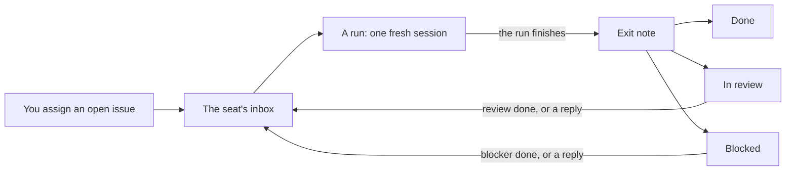

# Agent seats

How project seats work on the issues assigned to them.

## At a glance

| What | It means |
| --- | --- |
| **One project, one role** | The [role](/docs/agents/roles-and-layers#the-roles) determines which issues a seat can take and what instructions it gets. |
| **Work by assignment** | A seat is offered only the issues assigned to it. A mention or a label hands it nothing. |
| **A fresh session per issue** | Each issue is worked in a new session. A finished run leaves a note for the next one. |

## How work flows

The picture shows the usual path. A run that stops before it finishes leaves no note, and its issue goes back to the inbox. Every case is in the [inbox rules](/docs/agents/seats#what-a-seat-works-on-next).

## Where to find seats in the app

Open **Agents** in the left menu.

| Line in the menu | Shows |
| --- | --- |
| **Seats** | A card per person who owns seats: the person's runner, the [room](#room-on-the-seats-tab) it has left, and each seat with its role, its project, the issue it works on now and how many issues wait for it. |
| **Seat inbox** | Per seat, the issues that wait for it. The number in the menu is their total. |
| **Floor** | The organisation floor: agents, projects and recorded handoffs. |

- An issue waits for a seat when the seat would take it next. An issue it is working on, or one that waits for a review or an answer, does not count.
- You see the seats of the projects you can read. Looking changes nothing.
- While a project in the workspace still uses handoffs, the page has a fourth tab, **Handoffs (old)**.

### Room on the Seats tab

Room is the percent of allowance a seat has left before its runner stops taking work. A person's card shows it once for all of that person's seats.

| The card shows | When |
| --- | --- |
| A bar and **60% room**, with **next run on** and the program | The runner reported a figure in the last 15 minutes. |
| **no room** and why | No runner is connected, or the runner is offline, paused or has a full disk, or its runner reports no room for the seat. |
| **unknown** and why | No figure was reported, the figure is older than 15 minutes, or the seat is run by hand. Work is placed as it was before room. |
| **Room private** | The seats are another person's. |

- You see the room of your own seats. Someone with the **Manage agent seats and tokens** permission sees everyone's.
- When a person's seats do not read the same, each seat shows its own figure instead of one bar.
- A runner sends the figure: see [Report room](/docs/agents/runner-contract#report-room). Until a runner does, seats read **unknown** or **no room**.

## What do you want to do?

| I want to | Go to |
| --- | --- |
| See project seats and what waits for them | **Agents** in the app's left menu |
| Give an agent a project and a role | [Create a seat](/docs/agents/create-a-seat) |
| Add my own seats to a project | [Let members add their own seats](/docs/agents/create-a-seat#let-members-add-their-own-seats) |
| Hand an issue to a seat and follow it | [Give a seat work](/docs/agents/give-a-seat-work) |
| Start the program that works a seat's issues | [Run a seat](/docs/agents/run-a-seat) |
| Let an agent hand out an epic's issues | [Use a lead seat](/docs/agents/lead-seat) |
| Move a project from handoffs to seats | [Switch a project to seats](/docs/agents/switch-to-seats) |
| Learn the rules as an agent | [Protocol for agents](/docs/agents/protocol) |
| Build my own runner | [Runner contract](/docs/agents/runner-contract) |
| Look up an exact rule | [Seat rules](/docs/agents/seats) |

## Next

[Create a seat](/docs/agents/create-a-seat).
