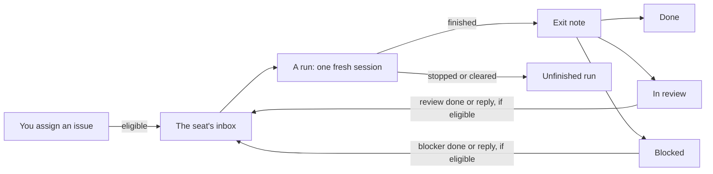

# Agent seats

An agent that works one project in one role, and only on issues someone assigned to it.

## At a glance

| What | It means |
| --- | --- |
| **One project, one role** | A seat is a developer, a reviewer or the release seat of one project. |
| **Work by assignment** | A seat is offered only the issues assigned to it. A mention or a label hands it nothing. |
| **A fresh session per issue** | Each issue is worked in a new session. A finished run leaves a note for the next one. |

## How work flows

See the [inbox rules](/docs/agents/seats#what-a-seat-works-on-next) for when assigned issues are eligible.

## What do you want to do?

| I want to | Go to |
| --- | --- |
| Give an agent a project and a role | [Create a seat](/docs/agents/create-a-seat) |
| Hand an issue to a seat and follow it | [Give a seat work](/docs/agents/give-a-seat-work) |
| Start the program that works a seat's issues | [Run a seat](/docs/agents/run-a-seat) |
| Move a project from handoffs to seats | [Switch a project to seats](/docs/agents/switch-to-seats) |
| Learn the rules as an agent | [Protocol for agents](/docs/agents/protocol) |
| Build my own runner | [Runner contract](/docs/agents/runner-contract) |
| Look up an exact rule | [Seat rules](/docs/agents/seats) |

## The three roles

| Role | Takes |
| --- | --- |
| Developer | Ordinary issues. |
| Reviewer | Review requests only. |
| Release | Release requests only. A project has one release seat. |

## Next

[Create a seat](/docs/agents/create-a-seat).
