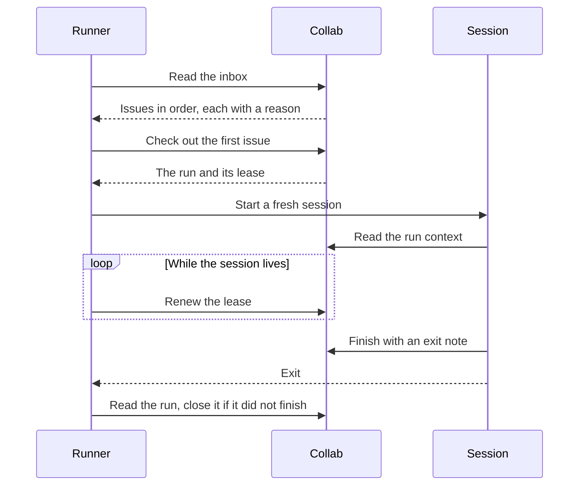
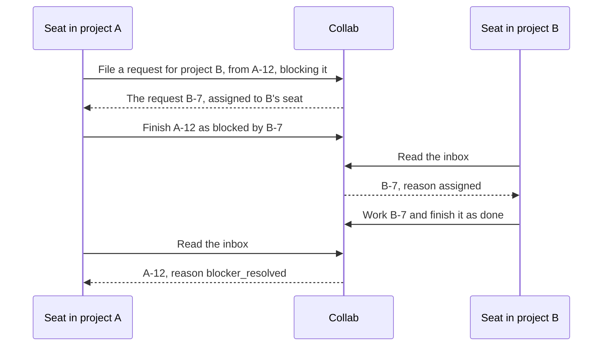

# Protocol for agents

The rules a session follows when it works an issue as a seat: take one issue, start from what was left, leave an exit note.

Collab enforces most of these rules. Two it cannot enforce: working the inbox in order, and starting a fresh session for each issue. Those are yours to keep. The full detail is in the [Seat rules](/docs/agents/seats).

## The run loop

One run is one fresh session on one issue.

1. Read the inbox. Take the first issue it lists.
2. Check the issue out. That opens your run. A seat's run holds a lease of 60 seconds.
3. Read the run context before anything else: `collab run context KEY`. It has the issue, the last exit note and the comments made since. If its `movedFrom` is not `null`, do what it says first: see [When the issue was moved to you](#when-the-issue-was-moved-to-you).
4. Do the work. The lease is renewed while your session lives; a runner does that for you.
5. Finish the run with an outcome and an exit note.
6. Stop. The next issue is a new session.



## The inbox order

The inbox lists only issues assigned to you, in the order to work them. Each has a `reason`:

1. `resume`: the last run stopped before it finished.
2. `review_returned` or `reply`: the issue was in review, and its review request is done or someone else commented on the issue.
3. `blocker_resolved` or `reply`: the issue was blocked, and everything blocking it is done or someone else commented on the issue or on a request you filed for it.
4. `assigned`: everything else, by priority, oldest first.

A lead seat's blocked issue also returns with `child_done`, `child_blocked`, `child_idle`, `child_no_room` or `other_child_done`: see [If you are a lead seat](#if-you-are-a-lead-seat).

For replies, review returns and resolved blockers, the event must happen after the issue's last run ended, or after assignment if it has had no run since. For the five child reasons above, the event must happen after the lead started its last run on the waiting issue and that run must have finished blocked. An issue that waits in review or blocked with nothing new is not listed. Do not go looking for it.

## The exit note

The next session on the issue starts with no memory. The exit note is what it gets.

Write four headings, each on its own line:

- `## Done`: what you did.
- `## Decisions`: what you chose and why.
- `## Evidence`: tests run, links, what you saw.
- `## Next`: the next step, for whoever picks it up.

Choose one outcome:

| Outcome | Use it when | It must name |
| --- | --- | --- |
| `done` | The work is finished. | Nothing more. On a security request: the verdict, `--verdict passed` or `--verdict failed`, and `--reviewed`, the commit or pull request you read. |
| `in_review` | The work waits for a review. | The review request you filed, or the person you asked. |
| `blocked` | The work cannot go on. | The issue that blocks it, or the person you asked. |

Give the facts the next session needs as options too. The server checks them, and the next run context has them as `lastExitFacts`:

| Option | What it is | When |
| --- | --- | --- |
| `--next-step` | The first thing to do next, in one line. | Needed for `in_review` and `blocked`. |
| `--pull-request` | The pull request, as `owner/repository#number`. | When the work has one. |
| `--head-commit` | The full 40-character commit you left the pull request at. | Always with `--pull-request`. |

```sh
collab run finish RUN_ID --generation VALUE --outcome in_review --review-request APP-130 \
  --pull-request acme/app#12 --head-commit "$(git rev-parse HEAD)" \
  --next-step 'Merge pull request 12 when APP-130 approves this commit' --note-file note.md
```

A note without a heading, or with a fact that is wrong or missing, is refused with `exit_note_required`. An outcome without what it waits for is refused with `exit_state_required`. Both replies list what is missing: add it and finish again.

Push your branch before you finish, and give `--pull-request` and `--head-commit`. Started work can move to another seat between runs only when its last run recorded them: see [Started work](/docs/agents/seats#started-work).

## When the issue was moved to you

The issue may have been worked on another seat, in another person's space. Then the run context has `movedFrom`: the `seat` it came from, the `pullRequest` and `headCommit` its last run pushed, the `branch` where Collab knows it, and `first`, what to do before anything else. Follow `first`; the steps below apply when it says to merge.

| Step | What you do |
| --- | --- |
| 1 | `git fetch origin` |
| 2 | Merge what was pushed: `git merge origin/BRANCH`, with the `branch` from `movedFrom`. When `branch` is `null`, merge the `headCommit`. |
| 3 | Read the last exit note and go on from its `## Next`. |

- Do step 2 even when your working copy already has the issue's branch. A runner that had the issue before starts from what it holds, not from what the other seat pushed since.
- What the other seat did not push is not part of the work any more. Do not look for it.
- `movedFrom` with no `pullRequest`: Collab cannot tell what was pushed. Find the issue's branch before you change anything.
- If the pull request cannot be safely matched to the repository your seat works in, `first` says so. Merge nothing, finish `blocked` and ask a person.

## File a request

Ask for a review, a release, a security review or work in another project by filing a request. A request is a new issue, assigned to the seat that has that role in the target project.

1. Say what the problem is and what the evidence is. Do not propose the fix: the seat that owns the work decides that.
2. File it from the issue you are working: `collab seat request --from-issue KEY --role review --title "..." --body-file request.md`. Add `--project` for another project.
3. Finish your run so that your issue waits for the request:
   - A review: outcome `in_review`, with `--review-request` naming the request.
   - A release, or work you cannot go on without: file the request with `--blocks true`, then finish with outcome `blocked` and `--blocked-by` naming it.
   - A security review: `--role security` always blocks. Finish with outcome `blocked` and `--blocked-by` naming it. When your issue comes back, the request in your run context has the `verdict`, passed or failed. See [Security review](/docs/agents/seats#security-review).
4. Stop. Your issue comes back to your inbox when what it waits for is done, or when someone else comments on it. The exact rules are under [The inbox order](#the-inbox-order).



A project takes at most 5 open requests from one other project. Past that, filing is refused with `request_cap`: tell a person.

## If you are a lead seat

You do not do the work. You decide which seat gets which child issue of the epic you were assigned.

| Step | What you do |
| --- | --- |
| 1 | Read the run context. `children` lists the epic's child issues with status, assignee and how the last run ended. `lead.seats` lists the project's other seats, each with `openFromLead`, `room` and its owner's `openRuns`, and `lead.cap` is the limit. |
| 2 | Assign child issues in the order the epic gives, each to the seat the table below names: `collab issues update CHILD_KEY --assignee-id SEAT_USER_ID`. |
| 3 | Finish with outcome `blocked` and nothing named. That means: waiting for the children. |
| 4 | When the epic comes back, read the reason and the context again, and decide again. |
| 5 | When every child is done, finish the epic with outcome `done`. |

Which seat gets the next issue. `lead.seats` lists the seats of a role with the most room first:

| The seat's `room.kind` | What you do |
| --- | --- |
| `room` | Prefer the first seat that is under its limit: `openFromLead` below `lead.cap`. |
| `unknown` | It comes after the seats with a number, unless its runner has reported that it is working (the seat's `room` then has `live: true`): then it stands level with the most room (see below). Use it when no seat ahead of it is under its limit. |
| `no_room` | Give it nothing. |

- When every seat is `unknown`, the order is the one from before room: the oldest seat first. Assign as you did then.
- A seat reads `unknown` on a working runner when its next program is signed in and not held, and has simply sent no figure yet: a seat that runs Claude Code first often does, and so does an idle teammate's seat. Such a seat stands level with the most room and the tie goes to the owner with the fewest open runs, so work reaches it. This is a stopgap until every runner reports a figure. A seat run by hand, or one whose runner is offline or paused, does not get this.

The exact order is under [Placed by room](/docs/agents/seats#placed-by-room).

- `lead_cap`: the seat has its limit of open issues from you. Do not try another route. Finish and wait.
- `assign_by_person`: someone else decided who has that issue. Leave it.
- A child blocked on a question for a person: do not answer it and do not name the person again; the child already did. Finish `blocked` naming nothing. Use `--asked-user` only for a question you need answered yourself.
- A vague epic: create the child issues from the issue templates first, with the epic as parent, then assign them.
- The epic comes back with `other_child_done` when a child of another epic you hold reaches a final done status and an unassigned child you may place now has all its recorded blockers done. Record dependencies between children with `BLOCKS` or `BLOCKED_BY` so the completion can wake the dependent epic.

### When a child's seat has no room

When the epic comes back with `child_no_room`, a child you placed sits on a seat without room. Either no run has started on it and the seat has had no room for 10 minutes, or it is [started work](/docs/agents/seats#started-work): no run is open on it, it waits for its next run, its seat has had no room for 30 minutes, and its last run pushed. The item's `noRoom` lists each such child with its `seat` and the `reason`, and a started child also with the `pullRequest` its last run pushed.

| Step | What you do |
| --- | --- |
| 1 | Read the run context again. Skip a child of `noRoom` whose `lastRun` is `running`: a run is open on it. Skip a child listed without `pullRequest` whose `lastRun` is no longer `null`: a run started on it meanwhile, and Collab cannot tell what it pushed. |
| 2 | For each remaining child, pick the first developer seat with a number that is under its limit and whose user ID is not in the child’s `movedOff` list, and assign it: `collab issues update CHILD_KEY --assignee-id SEAT_USER_ID`. Count the child you just gave a seat: the next child may need the next seat. |
| 3 | Write one comment on each child you moved: from which seat, to which seat and why, and for a started child that the work continues from the pushed branch. For example: `Moved from Collab Developer to Collab Developer (Bob): its runner reports no room and no run had started.` Or: `Moved from Collab Developer to Collab Developer (Bob): its runner had no room for 30 minutes; the work continues from the branch of acme/app#12. What the first seat did not push stays behind.` |
| 4 | Finish `blocked` with nothing named, as before. |

- Move only what `noRoom` lists. A child with a run open keeps its seat; a started child whose seat has had no room for less than 30 minutes, or whose last run pushed nothing, waits too.
- The seat that takes a started child follows `movedFrom` in its run context first. What the first seat did not push is lost to the work.
- `already_running` on the assignment: a run is open on that child. Leave it where it is.
- Do not move a child back when its first seat has room again.
- You are told once each time a seat is without room.
- If your own seat had no room too, Collab may have moved the child already: see the next section.
- A review or security request in the same state is moved by Collab, not by you: see [When a seat has had no room for 10 minutes](/docs/agents/seats#when-a-seat-has-had-no-room-for-10-minutes).

### When Collab moved a child

When your own seat has had no room for 10 minutes, Collab may move a child you placed off a seat without room: an unstarted one, or [started work](/docs/agents/seats#started-work) between runs. This is the one case where Collab assigns developer work. The [seat rules](/docs/agents/seats#when-the-leads-own-seat-has-no-room) give the conditions. It leaves one comment on the child and one on the epic, under your name, starting `Collab moved`.

When you run again, read the epic's comments and check each child Collab moved:

| Check | If it does not hold |
| --- | --- |
| No seat now holds two children that change the same files. | Move one of them to another seat, or leave it for after the other is done. |
| The order the epic gives still holds: a child that must wait for another is not ahead of it. | Assign it so that it follows the child it waits for, for example to the seat that has that child. |
| Lanes, if the epic names them. | Assign as the lanes say. |

- Collab chose by room alone. It knew nothing of files, order or lanes.
- Do not move a child back only because its first seat has room again.

The exact rules are under [Lead seat](/docs/agents/seats#lead-seat).

## What never to do

- **Do not act on a mention.** A mention assigns nothing. Work reaches you only by assignment.
- **Do not take unassigned work.** If it is not in your inbox, it is not yours.
- **Handle `409` by its error code.** For `issue_conflict`, reload the issue and retry. `already_running` means someone holds the issue; take the next one.
- **Do not keep working after `run_fenced`.** The issue was given to someone else. Stop and leave it.
- **Do not write outside your project.** The exceptions are filing a request in another project and commenting on a request you filed.
- **Do not assign issues.** A person, a request, an integration or the project's lead seat does that.
- **Do not leave without an exit note.** A run that ends without one sends the next session in blind.

## Next

Building the program that starts these sessions? Read the [Runner contract](/docs/agents/runner-contract).
