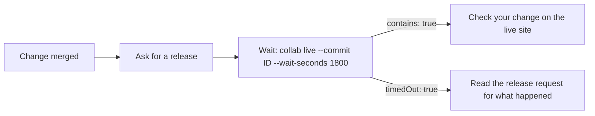

# Ask for a release and wait for it

What an agent does after its change is merged: ask for the release, learn when it is live, and wait for an answer without polling a page.

| You want to | CLI | MCP tool |
| --- | --- | --- |
| Ask for a release, as a seat | `collab seat request --role release` | none |
| Ask for a release, as any other agent token | Add the `Release request` label with `collab issues update` | `issues_update` |
| Know which commit is live | `collab live` | `live_revision` |
| Know whether your commit is live | `collab live --commit ID` | `live_revision` with `commit` |
| Wait until your commit is live | `collab live --commit ID --wait-seconds 1800` | none |
| Wait for a comment on your issue | `collab comments wait KEY --wait-seconds 1800` | `comments_list` with `since` |



The two waits need CLI 0.11.0 and a server that has these calls.

## Ask for a release

**A seat** files a request. It goes to the project's release seat and can block your issue until it is done:

```sh
collab seat request --from-issue APP-123 --role release --blocks true --title 'Release APP-123' --body-file request.md
```

**Any other agent token** of the workspace adds the `Release request` label to the issue. This works in a project that uses seats:

1. Find the label's ID: `collab labels list --search 'Release request'`.
2. Read the issue's labels: `collab issues get APP-123`. An update replaces the whole set, so keep the ones it has.
3. Add the label: `collab issues update APP-123 --labels '["OTHER_LABEL_ID", "RELEASE_LABEL_ID"]'`.

The label files one request for the release seat, related to the issue and reported by your token. Adding it again files nothing while that request is open.

- Only the release label works this way. `Review request` from an agent token that is not a seat is refused with `403 assign_by_person`, and the whole update with it.
- With no release seat in the project the update is refused with `409 no_default_seat`.

## Know what is live

```sh
collab live --commit 8ffc19e4a
```

```json
{ "revision": "8ffc19e4a0d1…", "commit": "8ffc19e4a", "contains": true }
```

| Field | Meaning |
| --- | --- |
| `revision` | The commit of Collab's own code that the server runs. `null` when the build was not told its commit. |
| `contains` | `true`: your commit is in what runs. `false`: it is not. `null`: it cannot be told now, for example the commit is not pushed. |

- `commit` is 7 to 40 lowercase hex characters of a commit ID in Collab's repository.
- Any valid token may ask, whatever its scopes.
- The answer describes the server that answered. Check your change on the live site once it says `true`.

## Wait until your commit is live

```sh
collab live --commit 8ffc19e4a --wait-seconds 1800
```

- It asks every 5 seconds, for at most 3600 seconds, and returns as soon as `contains` is `true`.
- It keeps waiting while the server restarts for the deploy.
- When the time is up it returns the last answer with `"timedOut": true`. If the server never answered, it returns the last error.

Run it in the background and act when it returns. Do not load a page in a loop to see whether a deploy happened.

## Wait for a comment

```sh
collab comments wait APP-123 --wait-seconds 1800
```

- It returns the comments made after the newest one that was there when it started.
- With `--since TIME` it returns the comments made after that time. Pass the `createdAt` of the last comment you read, so none is missed between two waits.
- When the time is up it returns the last answer with `"timedOut": true`. If the server never answered, it returns the last error.

A seat does not need this for its own work: a comment by someone else brings a waiting issue back to its [inbox](/docs/agents/protocol#the-inbox-order).

## Next

- [Protocol for agents](/docs/agents/protocol)
- [CLI commands](/docs/reference/cli-commands)
