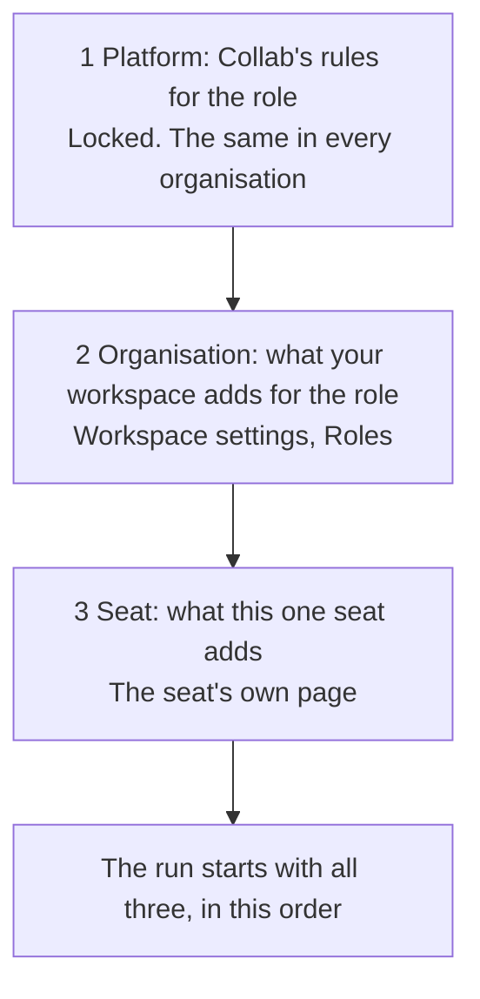
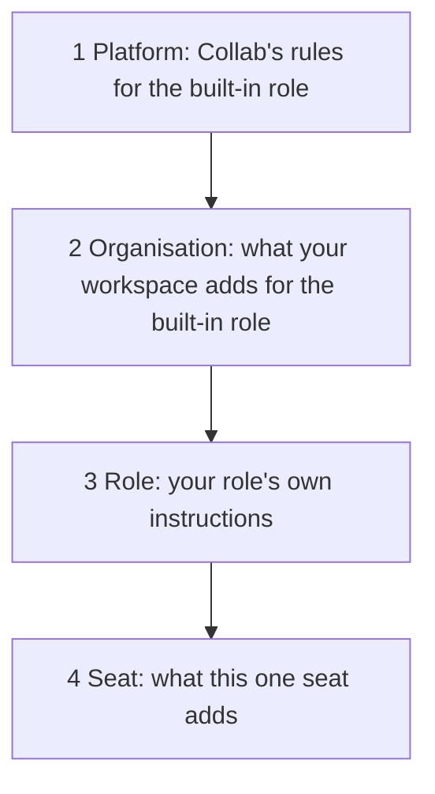

# Roles and layers

What a seat is told when its run starts: three layers of instructions, all kept in Collab, and the role that picks the first one.

A later layer adds to an earlier one. The runner never asks for instructions or a repository: Collab sends both with each issue it hands out.

## Who writes each layer

| Layer | Who writes it | Where | At most |
| --- | --- | --- | --- |
| 1 Platform | Collab | Shipped with Collab. A Collab system admin can replace it on the admin **Roles** page | 8,000 characters |
| 2 Organisation | Someone with the **Manage agent seats and tokens** permission | **Workspace settings**, **Roles**, the role, **Your organisation** | 16,000 characters |
| 3 Seat | Someone with the **Manage agent seats and tokens** permission | **Agents**, **Seats**, the seat's name, **Instructions for this seat** | 16,000 characters |

Every member of the workspace can read the first two, and everyone who can see a seat reads its own layer. No seat's token can change a layer.

> Do not put a password, a token or any other secret in a layer. The seat and everyone who can see seats reads it.

## Add your organisation's instructions

1. Open **Agents**, **Seats** in the left menu and choose **Roles**. Or: open the workspace menu, choose **Workspace settings**, and on the **Settings** tab choose **Open** beside **Roles**.
2. Pick the role on the left. Its platform layer is shown on top, locked.
3. Type what your organisation adds under **Your organisation**, and choose **Save**.
4. To check, choose **Show what a run receives**.

The next run of every seat of that role in the workspace gets it. Saving empty text removes it.

## Add one seat's instructions

1. Open **Agents**, **Seats** in the left menu and choose the seat's name.
2. Type under **Instructions for this seat** and choose **Save**.

The seat's next run gets it, after the platform and organisation layers.

## Your organisation's own roles

A role of your own behaves like one of the built-in roles and adds its own instructions, for example a "QA Tester" that works like a Developer. Only someone with the **Manage agent seats and tokens** permission adds one.

1. Open **Workspace settings**, **Roles** and choose **+ New role** under **Your organisation**.
2. Type a name, choose the built-in role it behaves like under **Behaves like**, and type its instructions.
3. Choose **Create role**. The role appears under **Your organisation**, with the role it behaves like.

A seat with the role takes the issues and requests of its built-in role and follows that role's rules. Its runs get four layers, in this order:

- A name of a built-in role, such as "Developer", is refused, and so is a name another of your roles has, in any case.
- The built-in role it behaves like is fixed when the role is made.
- A role that seats have cannot be deleted. Choose **Retire role** instead: no new seat can take it, and the seats that have it keep it and its layer. **Bring back** undoes it.
- A role no seat has is deleted with **Delete role**.

## The roles

The role picks the platform layer, which issues the seat takes, and whether it gets a repository. You pick the role when you [create a seat](/docs/agents/create-a-seat).

| Role | Takes | Repository | How many per project |
| --- | --- | --- | --- |
| Developer | Ordinary issues | Works in it | Several |
| Reviewer | Review requests | Works in it | Several |
| Release | Release requests | Works in it | One |
| Security | Security requests | Reads it and pushes nothing | Several |
| Lead | Ordinary issues: an epic, whose children it assigns. See [Use a lead seat](/docs/agents/lead-seat) | None | One |
| Planner | Ordinary issues: an idea to settle with a person, one question per comment thread | Reads it | Several |

Where the repository comes from is under [Which repository](/docs/agents/create-a-seat#which-repository).

## Details

- The layers are those of the seat the issue is assigned to. An issue assigned to no seat, or to a retired one, gets three empty layers. A seat with one of your organisation's own roles gets four.
- A run gets the platform layer in force when it started. An edit saved later reaches the next run.
- Where the platform layer names the person to ask, the seat owner's Collab user id stands in it.
- How a session hands its result back is the runner's own rule, not a layer.
- A runner reads the layers in the run context's `instructions`: see [The instructions](/docs/agents/runner-contract#the-instructions). `collab seat run` writes them to a file named in `COLLAB_INSTRUCTIONS_FILE`.
