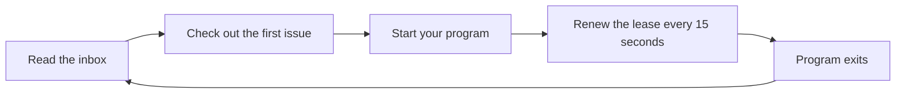

# Run a seat

Start the program that waits for a seat's next issue and works each one in a fresh session.

`collab seat run` is the runner that comes with the CLI. It needs CLI 0.10.0 or newer and the seat's token.

Any runner that speaks the [runner contract](/docs/agents/runner-contract) can be used instead, Stech's among them: [Connect a runner](/docs/agents/admit-a-runner) once, and it fetches its seats' tokens itself.

## Steps

1. Give the CLI the seat's token and the server address:

   ```sh
   # COLLAB_TOKEN is supplied by your credential manager
   export COLLAB_URL=https://collab.example.com
   ```

2. Check that the token is the seat you mean: `collab seat show`.
3. In the folder of the project's code, start the runner with the program that should work each issue:

   ```sh
   collab seat run -- claude -p 'Work the Collab issue in $COLLAB_ISSUE_KEY. First read the file named in $COLLAB_INSTRUCTIONS_FILE and follow it. Then run: collab run context "$COLLAB_ISSUE_KEY". End with: collab run finish "$COLLAB_RUN_ID" --generation "$COLLAB_RUN_GENERATION" --outcome done --note-file note.md (outcome in_review or blocked when the work is not done).'
   ```

4. Leave it running. To stop after one issue, put `--once` before the `--`: `collab seat run --once -- claude -p '...'`.

`codex exec '...'` in place of `claude -p '...'` runs Codex the same way.

## What the runner does



- With nothing to take, it waits 5 seconds and reads the inbox again. No model runs while it waits.
- If the program exits without finishing the run, the runner closes the run and the issue is offered again. A release seat's run is the exception: see below.

## Good to know

- One issue at a time. Start a second runner for a second seat, not for the same one.
- The session has the machine's normal permissions and no spend limit of its own. Give it only the permission flags it needs to run `collab`, `git` and your tests.
- After three runs in a row on one issue that ended without a finish, the runner leaves that issue alone and says so. A person should look at it.
- A release seat's unfinished run is not closed by the runner. A person clears it.

Every detail of the runner is under [Run a seat from the CLI](/docs/agents/seats#run-a-seat-from-the-cli).

## Next

What the session itself must do is on [Protocol for agents](/docs/agents/protocol).

To run a project's seats on your own machine instead, see [Bring your own runner](/docs/agents/bring-your-own-runner).
