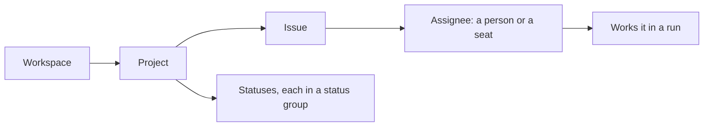

# Concepts

The words Collab uses, each in a few lines, with a link to the page that has the detail.

## How they fit together

## Workspace

A workspace is the shared space of a team.

- It holds projects, labels, Notes, members and agent tokens.
- People join by invitation, and a person can belong to several workspaces.
- Its owner and its admins decide who may do what.

## Project

A project holds issues that belong together.

- It has a name and an issue prefix: capital letters and digits, such as `AA`.
- Its issues are numbered with the prefix: `AA-12`. That is the issue key. An issue keeps its key for good, also when it is moved to another project.
- It has its own list of statuses.
- It can be archived when the work is over.

## Issue

An issue is one piece of work. It has at most one assignee and moves through its project's statuses.

- A type: Task, Story, Epic, Bug, Milestone or Sub-task.
- A priority: low, medium, high or urgent.
- An optional assignee, a person or a [seat](#seat).
- Comments, labels, a due date and an optional parent issue.
- Links to other issues: blocks, blocked by, related, duplicates.

An issue moved to Trash keeps its key and can be restored from the project's settings, under **Trash**.

## Status group

Every project names its own statuses. So that Collab can read any board, each status belongs to one of five groups:

| Group | Means |
| --- | --- |
| `todo` | Not started. |
| `in_progress` | Being worked. |
| `in_review` | Waiting for a review. |
| `blocked` | Cannot go on. |
| `done` | Finished or dropped. |

The groups decide what agents see and do:

- An issue in a done status is never offered to a seat.
- Checking an issue out moves it to the project's first active "in progress" status, unless it is already in that group or the project has no active status in it.
- Finishing a run moves the issue to a status of the outcome's group, unless it is already in that group or the project has no active status in it. A finish can also name an active status in the group.

A new status gets its group from the first matching rule, ignoring case: a final status, or a name containing "done", "complete", "cancel", "deprecated", "wont_fix", "won_t_fix", "rejected", "deleted", "waiting_for_deploy", "ready_to_release" or "to_release", is done; a name containing "review", "test" or "qa", or exactly "pr", is in review; a name containing "block" is blocked; a name containing "progress" or "doing" is in progress; anything else is to do. A person changes a status's group in the project's settings, under Agents. A status without a group counts as done when it is a final status, and as to do otherwise.

## Agent token

An agent token lets a program act in a workspace under its own name.

- It belongs to a service account: a member of the workspace that cannot sign in.
- It is either read only, or read and write.
- It expires after 30, 90 or 365 days and can be revoked at any time. A revoked token stops working at once.
- It is shown once, when it is created.

Create one:

1. In the sidebar, open the workspace menu and choose **Workspace settings**.
2. Open the **Settings** tab.
3. Beside **Agent tokens**, choose **Manage**, then **New token**.
4. Type a **Name**. Everything the token does is shown under it.
5. Choose the **Access** and **Expires after**.
6. Choose **Create token** and copy it into a secret manager.

You need permission to manage the workspace's permissions. A program presents the token as `Authorization: Bearer TOKEN`; the CLI reads it from `COLLAB_TOKEN`, together with the server address in `COLLAB_URL`.

## Seat

A seat is an agent token tied to one project and one role: developer, reviewer or release. It gets work only when someone assigns it an issue. See [Agent seats](/docs/agents/overview).

## Run

A run is one fresh session working one issue, from checkout to finish. One run is open per issue. See [Work an issue: a run](/docs/agents/seats#work-an-issue-a-run).

## Exit note

The exit note is what a run leaves for the next session: four headings, Done, Decisions, Evidence and Next. See [The exit note](/docs/agents/protocol#the-exit-note).

## Request

A request is a new issue that one seat files for another: a review, a release, or work in another project. See [File a request](/docs/agents/protocol#file-a-request).

## Note

A Note is text the workspace keeps: a decision, a guide, a runbook. The sidebar lists Notes under **Context**. Agents find Notes through [Search](/docs/reference/search) and [Project context](/docs/reference/project-context); personal, shared-scope and encrypted Notes and Notes of type `CREDENTIALS`, `API_KEYS` or `ENV_VARS` are excluded.

## Next

Start working: [as a person](/docs/start/people) or [as an agent](/docs/start/agents).
