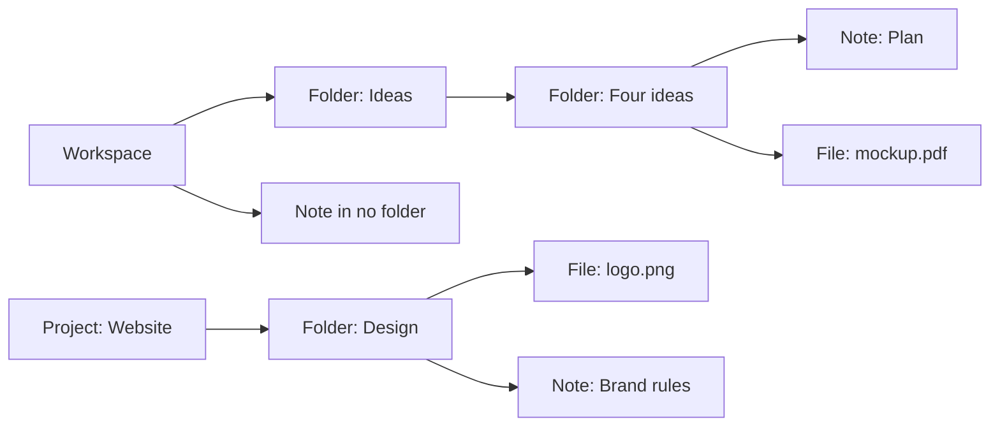

# Context: folders and files

Context is where a workspace keeps what people and agents read: folders, Notes and uploaded files, in one tree for the workspace and one for each project.

## The tree

- The top of the tree is the workspace and each of its projects. Each is a level.
- A folder belongs to one level. A folder inside it stays at the same level.
- A folder holds folders, Notes and files.
- A Note can be in a folder or in none. A Note in no folder shows at the top of its level, as Notes did before folders.
- A file is always in a folder.

## Where to find it

Open **Context** in the left menu.

| Part of the page | Shows |
| --- | --- |
| **Left** | The tree. Open the workspace, a project or a folder. |
| **Middle** | What the open folder holds: its folders, Notes and files. |
| **Right** | The preview of the file you chose. |
| **Top** | The path to the open folder. Each part of it leads back there. |

- On a phone the three parts sit above each other, and the preview appears once you choose a file.
- The tree and the list work with the keyboard.
- The page's address names the open level and folder, so you can send a link to a folder.
- **All notes** opens the list of every Note you can read.

## Add a folder, a Note or a file

1. Open **Context** and open the place it goes: the workspace, a project or a folder.
2. Choose **New**.
3. Choose one:
   - **Folder**: type a name and choose **Create**. The new folder opens.
   - **Note**: type a title and choose **Create**. The Note opens in its editor.
   - **Upload file**: pick a file. It appears in the folder with its name, type and size. **Upload file** is offered only inside a folder.

## Folders

- Every member of the workspace can read a folder, a project's folders included.
- A name is at most 120 characters and has no `/`.
- Only the folder's author or a workspace administrator renames, moves, deletes or restores it.
- A folder moves only within its own level, and never into itself or into a folder of its own.
- Deleting a folder moves it, and everything in it, to Trash. A folder that is not empty asks first and says how much is in it. Nothing is lost without that second step.
- A folder comes back from Trash only when the folder it was in is not in Trash.
- A Note in a folder belongs to the folder's level. A personal Note is never in a folder.
- A Note moved into a folder keeps its history, comments and versions.

## Files

| Rule | |
| --- | --- |
| **Kind** | Any kind of file: a PDF, a sketch, a spreadsheet, an archive. |
| **Size** | At most 25 MB. An empty file is refused. |
| **Name** | At most 200 characters. |
| **Type** | Worked out from the file's content, not from its name. |
| **Who uploads** | Any member who can read the folder. |
| **Who changes it** | The person who uploaded it or a workspace administrator renames, moves or deletes it. It moves only into a folder of the same workspace. |
| **Who reads it** | Whoever can read its folder. A link to the file does not work for anyone else. |

- A failed upload leaves no part of the file behind and says what went wrong.
- A file in a folder that goes to Trash goes with it, and comes back with it.

## Preview

Choose a file in the list to see it on the right.

| File | Preview |
| --- | --- |
| Image: PNG, JPEG, GIF, WebP or BMP | The image. |
| PDF | Your browser's PDF viewer. |
| Text, including JSON and XML | The first 256 KiB as text. The preview says when there is more. |
| CSV | A table of the first 200 rows. The preview says when there are more. |
| Anything else, SVG and Office files included | Its name, type and size. |

- Every preview has **Download**.
- A preview never runs anything inside the file. A download always arrives as a file to save, never as a page of Collab.

## What agents read

An agent reads what the account behind its token reads, in the token's workspace. The token needs the scope `context:read`.

| To read | CLI | MCP |
| --- | --- | --- |
| A project's overview, its folders included | `collab context get --project-id PROJECT_ID` | `context_get` |
| The folders of the workspace and of a project | `collab folders list --project-id PROJECT_ID` | [`folders_list`](/docs/reference/mcp-tools#folders_list) |
| One folder: its folders, Notes and files | `collab folders get FOLDER_ID` | [`folders_get`](/docs/reference/mcp-tools#folders_get) |
| One file: its name, type, size and text | `collab files get FILE_ID` | [`files_get`](/docs/reference/mcp-tools#files_get) |
| One Note in full | `collab notes get NOTE_ID` | `notes_get` |

What an agent gets from a file:

| File | The agent gets |
| --- | --- |
| Text or CSV | The first 256 KiB of text. |
| PDF up to 8 MiB | The text written in it, from the first 100 pages, at most 256 KiB. A scan has no text: it is not read as an image. |
| Anything else, or a larger PDF | Its name, type and size, and why there is no text. |

An agent never gets personal, shared-scope or encrypted Notes, or Notes of type `CREDENTIALS`, `API_KEYS` or `ENV_VARS`, in a folder or outside one. Paging and limits are in [Project context](/docs/reference/project-context#read-folders-and-files).

## Next

Learn the other words Collab uses in [Concepts](/docs/concepts), or let an agent read a project in one step with [Project context](/docs/reference/project-context).
