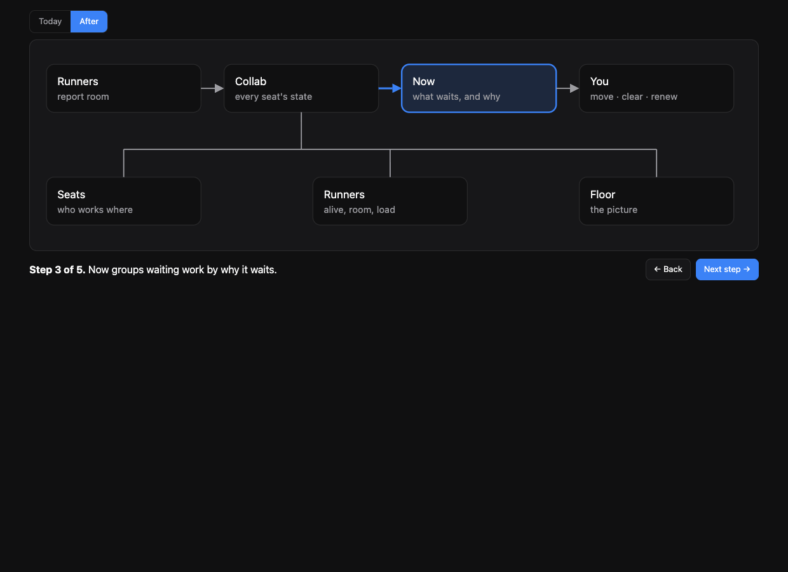
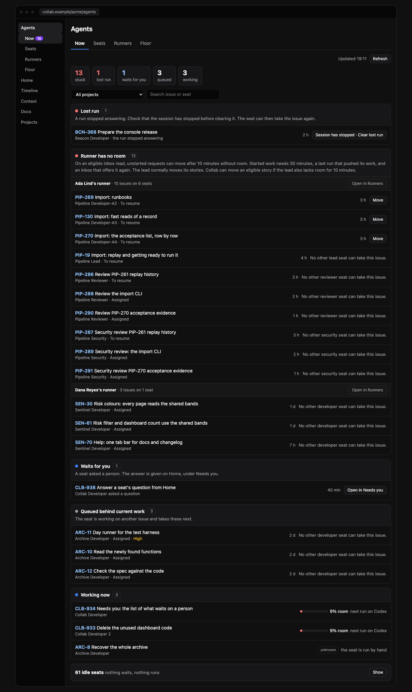
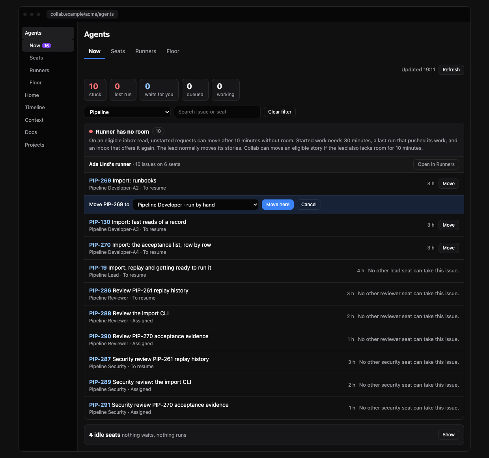
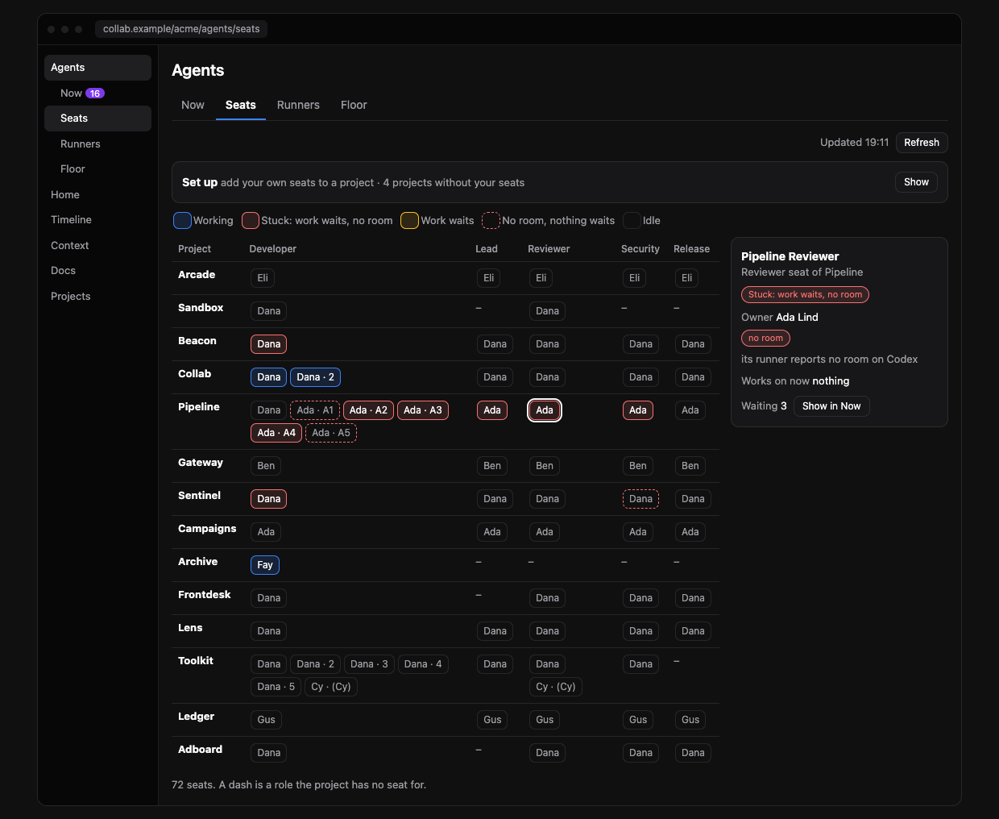
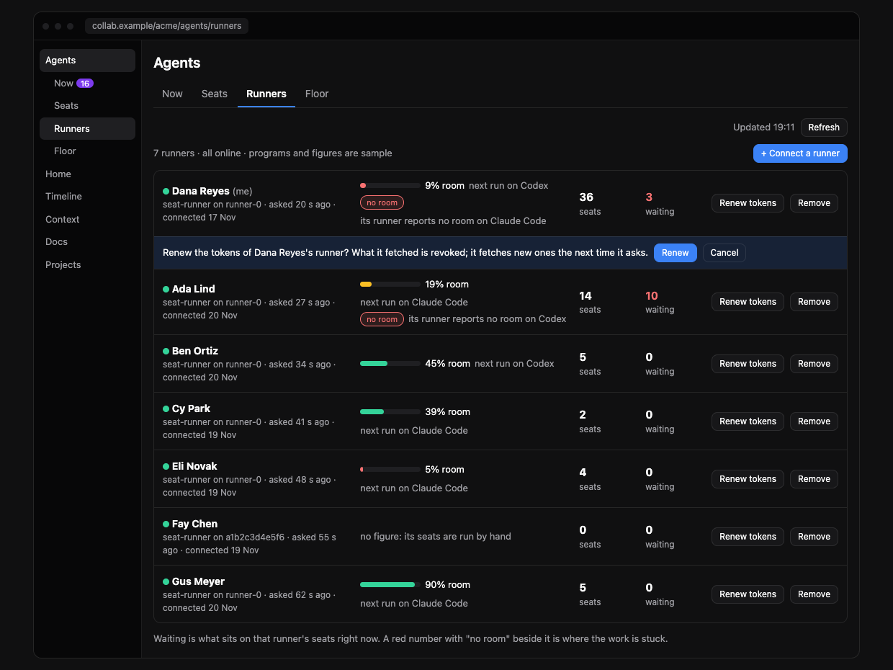
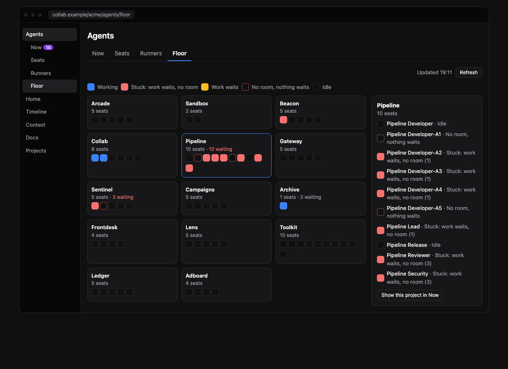
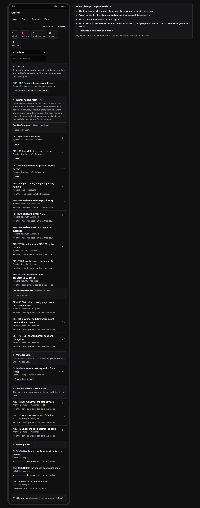

# Agents pages revamp: the approved screens

The screens the repository's owner approved on 22 November 2026 for the four tabs of the Agents page. Build to these. Where a story and a screen disagree, ask before building.

All names, projects, issues and numbers in the pictures are sample data. `mockup.html` in this folder is the clickable page the pictures were taken from; open it in a browser to try each control. Its layout switches, its "Your pick" forms and its last tab ("Open points") are left from the review; what was picked is written on this page.

## The three lines

- **Who is waiting:** the repository's owner.
- **First day:** he opens Agents and sees in one screen which work is stuck on which seat, and why.
- **Smallest version:** the Now tab alone, with only the seats that have waiting work, each row with its age and the reason it waits.

## The problem

Read on the live page on 22 November 2026, against commit `3e0e289` of `main`.

| Tab today | What a person gets |
| --- | --- |
| Seats | 12 rows of setup first, then 72 table rows grouped by person |
| Inbox | One card per seat: 72 cards, 64 of them "Nothing waits for this seat" |
| Floor | The old handoff agents (`readAgentFloor` reads registrations and handoffs, no seat) |
| Runners | Name, owner, seat count and two timestamps; six runners share one name |

16 issues were waiting. 13 of them sat on seats whose runner reported no room. No tab says that in one place: Inbox shows that an issue waits, Seats shows the room, Runners shows whose runner it is.

## What changes

| | Today | After |
| --- | --- | --- |
| Tabs | Seats · Inbox · Floor · Runners | **Now · Seats · Runners · Floor** |
| Agents opens on | Seats | Now |
| Left menu | Seats, Seat inbox, Floor | The same four tabs; the count sits on Now |
| Refresh | Floor every 20 seconds, the rest never | No timer anywhere: "Updated 19:11 · Refresh", and a reload when the person comes back to the browser tab |
| "Handoffs (old)" | Listed while a project uses handoffs | Unchanged |

Addresses: `/agents` is Now, `/agents/seats` is Seats (today that address is refused on purpose), `/agents/runners` and `/agents/floor` stay, and `/agents/inbox` leads to `/agents`.

## Now (replaces Inbox)

Approved layout: **grouped by why it waits**.

| Group | When | Action on the row |
| --- | --- | --- |
| Lost run | A run stopped answering | Confirm the session has stopped and clear the lost run |
| Runner has no room | The seat's runner reports no room; one sub-heading per runner | Move |
| Waits for you | A seat asked a person | Open in Needs you |
| Seat is run by hand | No runner starts the seat | Move |
| Queued behind current work | The seat is working on another issue | Move |
| Next in line | The seat has room and takes it by itself | Move |

A group with nothing in it is not shown. Above the groups: five counts, a project filter, a search over issue and seat. Below them: what each seat works on now, and one line for the idle seats ("61 idle seats · Show").

**Move** hands a waiting issue to another seat of the same project and role. It is a manual override. On an eligible inbox read, Collab can move an unstarted request after 10 minutes without room. Started work needs 30 minutes without room, a last run that pushed its work, and an inbox that offers the issue again. The lead normally moves its stories. Collab can move an eligible lead-assigned story when the lead has also had no room for 10 minutes (see `../seats-by-room/README.md`). A seat with no room cannot be chosen. When no other seat of the role can take it, the row says so and offers nothing.

**Clear lost run** is what the issue's Activity tab does today (`POST /api/issues/:issueId/runs/:runId/clear`), for a person who may assign issues. Check that the session has stopped before clearing the run. Clearing it offers the issue to the seat again.

**How long it has waited** is on every row. The inbox item carries the last run's time and no "waiting since" (`InboxItem` in `src/lib/agent-runs.ts`), so this needs a small change to the read. The ages in the pictures are sample.

**Waits for you** appears once "Needs you" is on the workspace Home. Until then the group is not shown.

## Seats

Approved layout: **projects × roles grid**. It replaces the per-person cards approved on 19 November for the desktop.

- One pill per seat, labelled with its owner. Its colour is its state; a dash is a role the project has no seat for.
- Pressing a seat shows its owner, room, current work and waiting count, with "Show in Now".
- "Set up" holds the owner's switch and "Add my seats" per project, folded away by default.

## Runners

- The person comes first, because several runners have the same name. Renaming runners is not part of this.
- Online means the runner asked in the last 5 minutes.
- Room is shown per program. "Waiting" is what sits on that runner's seats now; it is red when that work is stuck.
- Renew tokens and Remove exist today; each asks under its row, not in a dialog. "Connect a runner" is behind one button.

## Floor

Approved layout: **flat map**. The 3D scene goes.

One room per project, one desk per seat, coloured by the seat's state. Pressing a room lists its seats, with "Show this project in Now". The list of registered agents and the handoff counts leave this tab.

## On a phone

Rows stack, nothing is a table, and Move opens under its row. The four tabs scroll sideways. Seats uses one card per person at phone width, because a five-column grid does not fit. Floor is the flat map.

## Decided

| Point | Decision |
| --- | --- |
| The page's job | A stuck-work page for a person, not a mirror of each seat's inbox |
| Scope | All four tabs; "Handoffs (old)" is not touched |
| Actions | Move, Clear lost run, Renew tokens. Everything else is a link to the issue |
| "Needs you" on Home | Stays a separate page; a row here links to it |
| Idle seats | One line, opened on request |
| Room stays private | The owner and the lead see every figure, a member sees their own. For someone else's seat a member sees "no room" without a number. Today such a seat reads "Room private", so this shows a member one more fact: it needs a security review |
| When room comes back | Not shown: a runner reports how much room is left, not when it resets |
| Refresh | No timer on any tab |

## Build order

One tab at a time: **Now, then Runners, then Seats, then Floor.** The next one starts only when the one before is switched on in production and has been used once. At most two developer seats work at the same time.

## Not in this version

- Any change to how Collab places or moves work by itself.
- Reordering a seat's waiting work, or changing an issue's priority from the row.
- Renaming runners.
- A light theme for the mockup: the pictures show the dark theme only.
