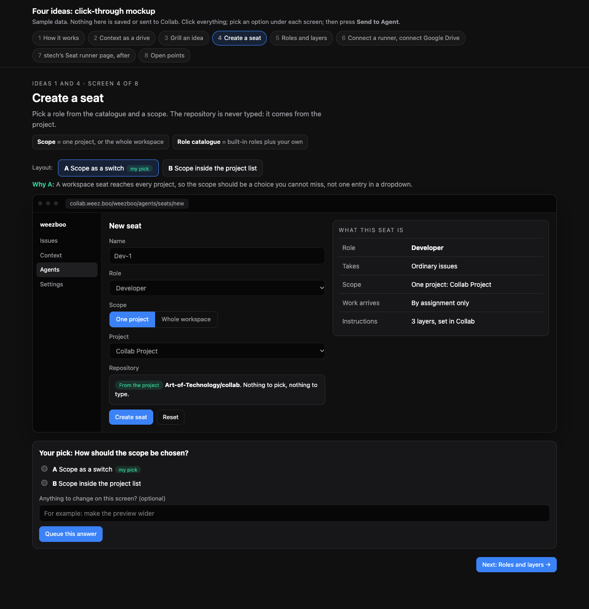
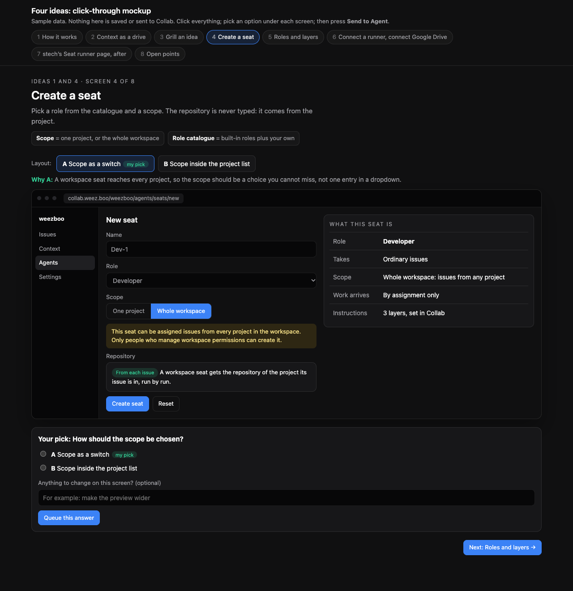
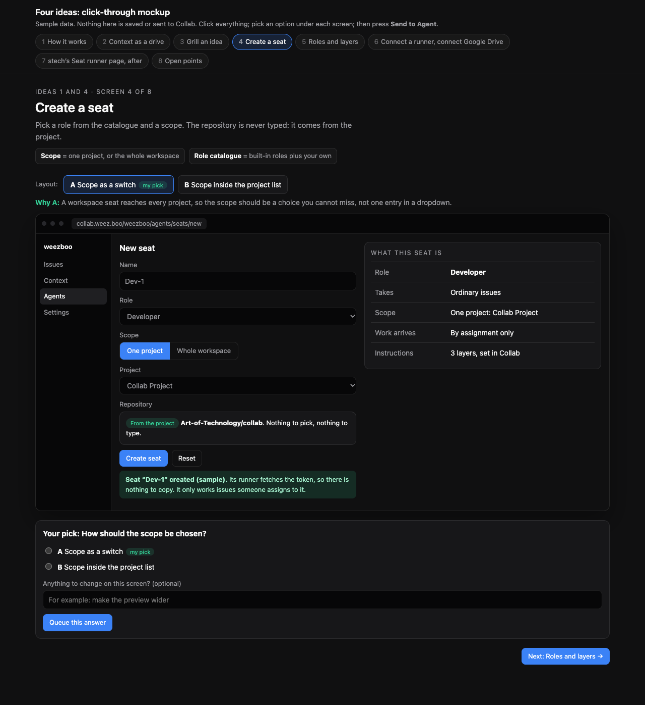
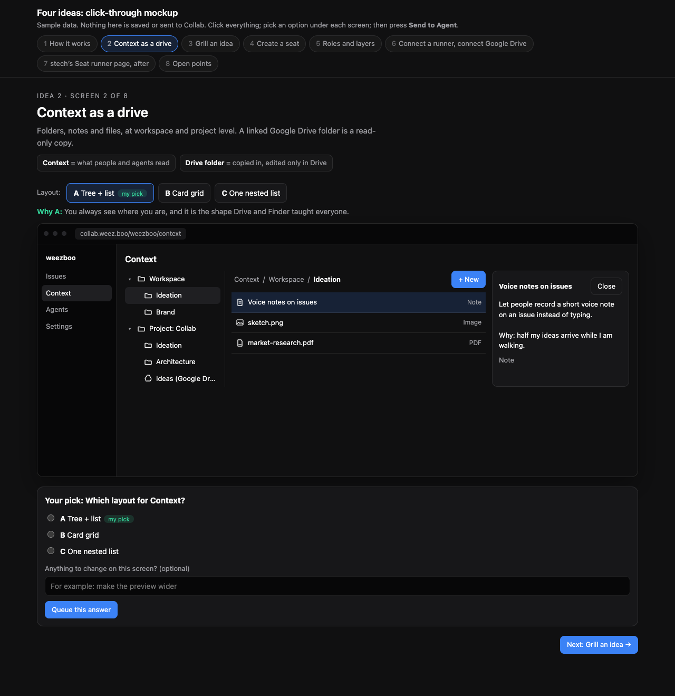
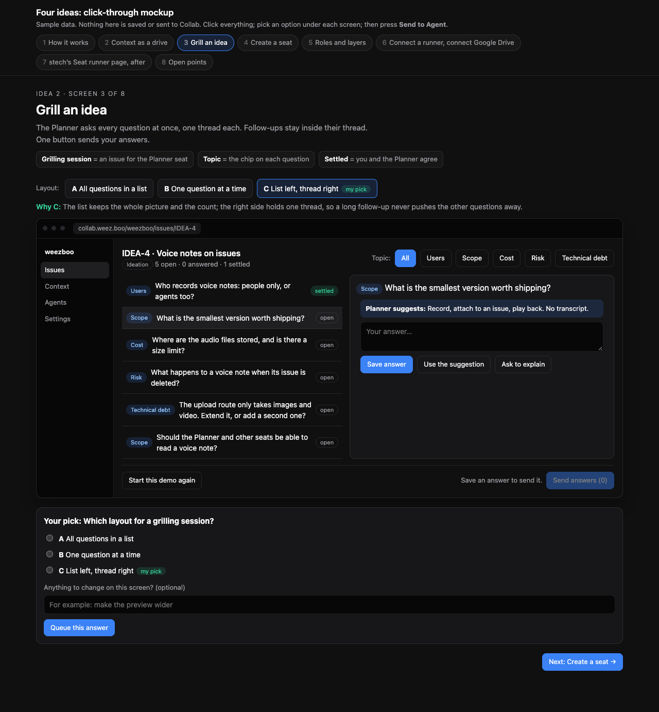
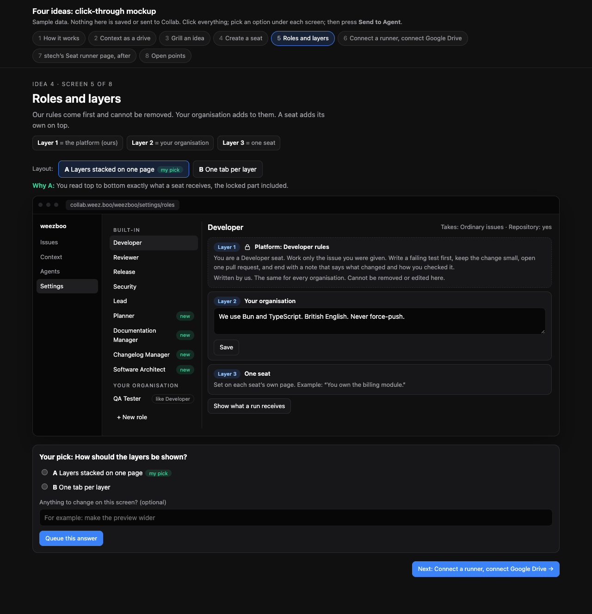
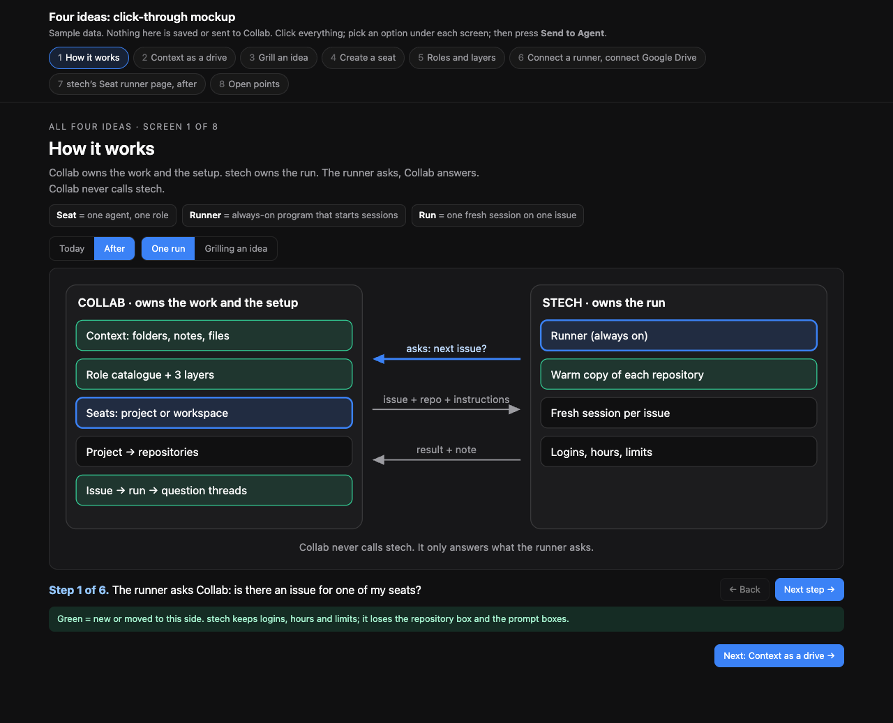
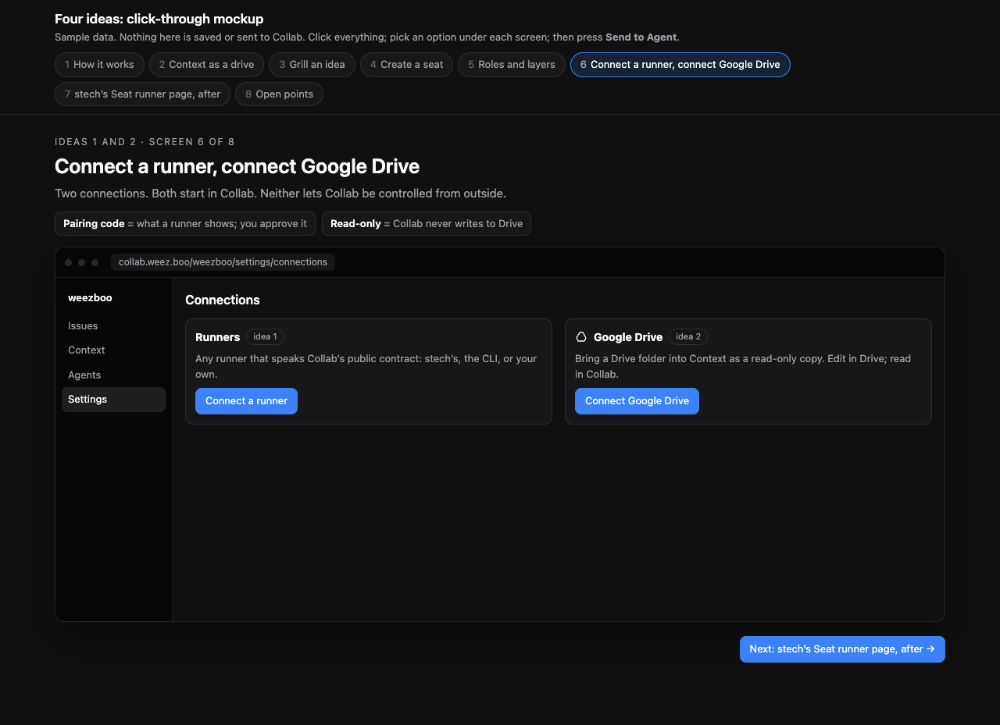
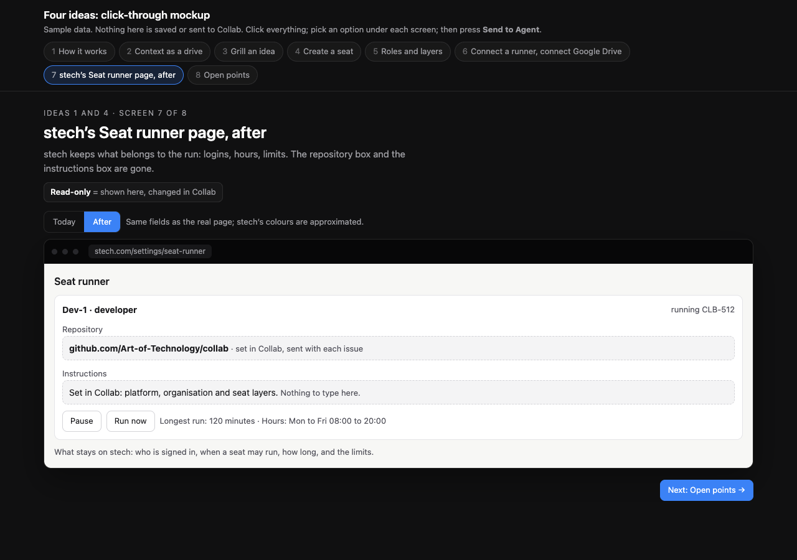

# Four ideas: the approved screens

The screens the owner picked on 17 November 2026 for the plan "Seat setup lives in Collab, generic seats, Context as a drive, Grill an idea" (milestones CLB-594 to CLB-598). Build to these. Where a story and a screen disagree, ask before building.

All names and numbers in the pictures are sample data. `mockup.html` in this folder is the clickable page the pictures were taken from; open it in a browser to try each control. Its layout switches, its "Your pick" forms and its last tab ("Open points") are left from the review; what was picked is written on this page, and the open points were settled in the plan.

| Screen | Picked layout | Picture |
| --- | --- | --- |
| How it works | (overview, no choice) | [01](01-how-it-works.png) |
| Context as a drive | **A**: a folder tree on the left, the open folder's list in the middle, the preview beside it | [02](02-context-as-a-drive-layout-a.png) |
| Grill an idea | **C**: the list of questions on the left and the open thread on the right | [03](03-grill-an-idea-layout-c.png) |
| Create a seat | **A**: the scope is a two-way switch, "One project" or "Whole workspace" | [04](04-create-a-seat-one-project.png), [05](05-create-a-seat-whole-workspace.png), [06](06-create-a-seat-created.png) |
| Roles and layers | **A**: the layers stacked on one page, the locked platform layer on top | [07](07-roles-and-layers-layout-a.png) |
| Connect a runner, connect Google Drive | (no choice) | [08](08-connect-a-runner-and-google-drive.png) |
| stech's Seat runner page, after | (no choice) | [09](09-stech-seat-runner-page-after.png) |

## Create a seat

## Context as a drive

## Grill an idea

## Roles and layers

## The rest

