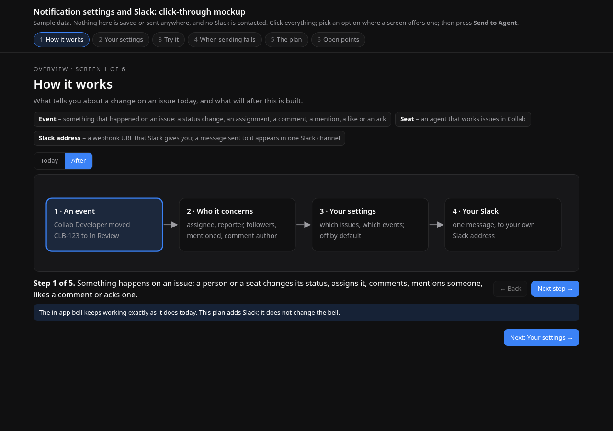
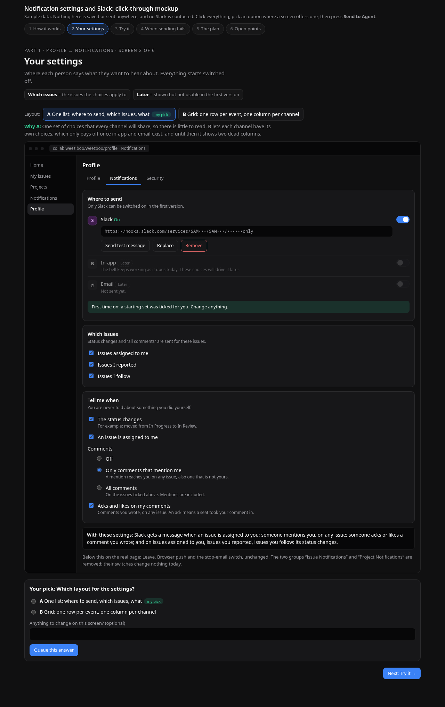
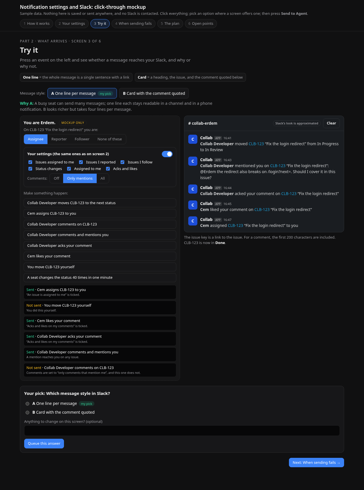
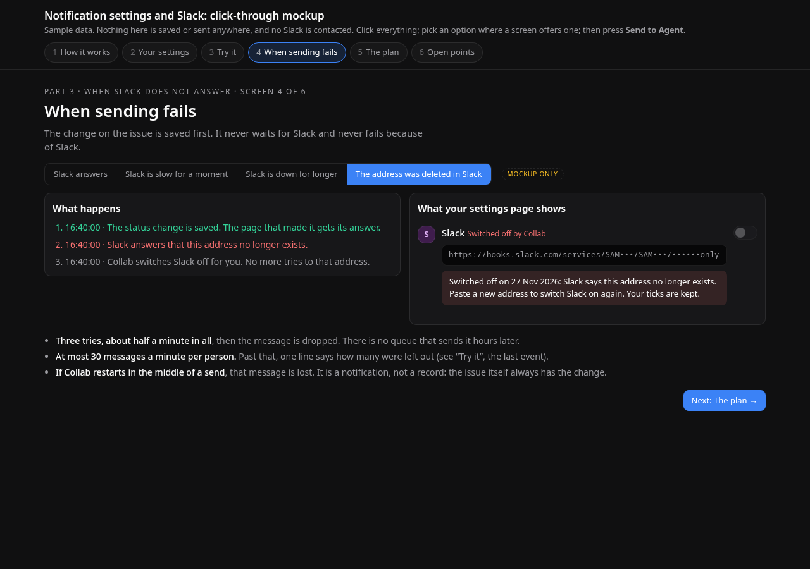

# Notification settings and Slack

Design note. Approved by Erdem on 27 November 2026 in a clickable mockup; the approved screens are the pictures in this folder.

## The problem

A person who works with agent seats is not told what the seats do.

- A change made by a seat (status, assignment, comment, mention, ack) creates no notification of any kind. Only changes made in the browser do.
- A new comment, a like or an ack on a comment notifies nobody, whoever makes it. Only an @mention does.
- A status change is not told apart from any other edit: the in-app line is "updated an issue".
- The "Issue Notifications" and "Project Notifications" switches on Profile → Notifications change nothing: the page saves one record and the senders read another.
- Nothing can be sent to Slack.

## What is added

Each person chooses, per workspace, what they want to hear about, and gives Collab the address of their own Slack channel. When something happens on an issue, Collab works out who it concerns, applies each person's choices, and posts one line to that person's Slack.

The in-app bell keeps working exactly as it does today. This design adds Slack; it does not change the bell.

## The settings

On Profile → Notifications, in place of the two groups that change nothing today.

**Where to send**

- **Slack.** A switch, and the address of a Slack incoming webhook. The address must start with `https://hooks.slack.com/services/`; anything else is refused. It is stored encrypted, is never sent back to the browser, and is shown masked. Beside it: "Send test message", "Replace", "Remove".
- **In-app** and **Email** are shown greyed and marked "Later". They cannot be switched on.

**Which issues**

- Issues assigned to me
- Issues I reported
- Issues I follow

**Tell me when**

- The status changes
- An issue is assigned to me
- Comments: Off, Only comments that mention me, or All comments
- Acks and likes on my comments

Under the choices, one sentence says in words what Slack will get with the current choices, or why nothing is sent.

## Rules

1. Settings are kept per person per workspace.
2. Everything is off for everyone until that person acts. Saving an address switches Slack on; the switch beside it switches it off and on again.
3. The first time Slack is switched on, by saving an address or with the switch, and nothing is ticked, Collab ticks a starting set: all three "which issues" boxes, status changes, assigned to me, comments set to "only comments that mention me", and acks and likes. Ticks the person already made are kept, also on later switch-ons.
4. Removing the address switches Slack off and keeps the ticks.
5. Who is told about what:

   | Event | Told | Needs |
   | --- | --- | --- |
   | The status of an issue changes | Its assignee, its reporter, its followers | "The status changes", and the matching "which issues" box |
   | An issue is assigned to someone, also at creation | The new assignee | "An issue is assigned to me" |
   | A comment or a reply is added | The issue's assignee, reporter and followers | Comments set to "All comments", and the matching "which issues" box |
   | A comment or an issue description mentions someone | The person mentioned, on any issue | Comments set to "Only comments that mention me" or "All comments" |
   | A comment is liked | The comment's author, on any issue | "Acks and likes on my comments" |
   | A seat acks one or more comments | The author of those comments, on any issue | "Acks and likes on my comments" |

6. Nobody is told about their own action.
7. Only people are told. An agent seat's account receives nothing from this; a seat has its inbox. A seat's action does notify people.
8. A person is told only about an issue they can read at the moment of sending.
9. One event gives one person at most one message. A comment that mentions a person who would also get it as a comment arrives once, with the mention wording. A person who is both assignee and follower gets one message.
10. Nothing is sent for: an edit of a comment (also when the edit adds a mention), an unassignment, a like that is taken back, an issue moved to the trash.
11. A description mention notifies at the same moments as the existing in-app mention notification for descriptions.
12. A seat's question to its owner stays in-app only in this version.

## The messages

One line each. The issue key is a link to the issue.

| Event | Message |
| --- | --- |
| Status | `{actor} moved {KEY} “{title}” from {old status} to {new status}` |
| Assignment | `{actor} assigned {KEY} “{title}” to you` |
| Comment | `{actor} commented on {KEY} “{title}”: {excerpt}` |
| Mention in a comment | `{actor} mentioned you on {KEY} “{title}”: {excerpt}` |
| Mention in a description | `{actor} mentioned you in the description of {KEY} “{title}”` |
| Like | `{actor} liked your comment on {KEY} “{title}”` |
| Ack of one comment | `{seat} acked your comment on {KEY} “{title}”` |
| Ack of several comments at once | `{seat} acked {n} of your comments on {KEY} “{title}”` |
| Test | `This is a test from Collab. Your notifications will arrive in this channel.` |
| Over the limit | `{n} more notifications were not sent in the last minute` (for one: `1 more notification was not sent in the last minute`) |

`{excerpt}` is the first 200 characters of the comment as plain text, with "…" when it was cut. `{actor}` is the name of the person or seat who did it, in bold.

## Sending

- The change on the issue is saved first. Sending starts after that, never delays the answer to whoever made the change, and never fails it.
- A message that Slack does not accept is tried three times in all: at once, 5 seconds later, and 30 seconds after that. Then it is dropped. There is no queue that sends it later; a restart of Collab in the middle of a send loses that message.
- When Slack answers that the address no longer exists, Collab switches Slack off for that person and the settings page says so with the date. The ticks are kept.
- When the last message could not be delivered, the settings page says so with the date. Slack stays on.
- At most 30 messages a minute per person. Past that, messages are dropped and one line says how many.

## What must not change

- The in-app bell and browser push: the same notifications, to the same people, as today.
- The answers of the issue, comment and run calls that agents and runners use. No new field, no new failure.
- Leave, Browser Push and the stop-email switch on the settings page.

## Not in this version

- In-app and email driven by these choices.
- A switch for a workspace owner to forbid Slack.
- Choices per project, quiet hours, a digest.
- App webhook events for comments and runs (for systems such as Stech). That is its own plan.

## Separate fix in the same batch

The Leave and Post switches on the same page have the fault described above: the page saves the record of the current workspace and the senders read the record without a workspace. The senders are changed to read the record the page saves, falling back to the old one.
