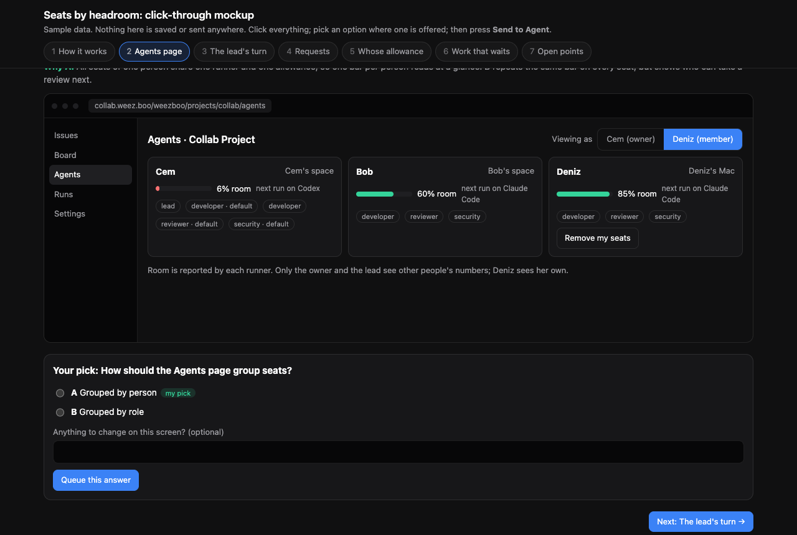
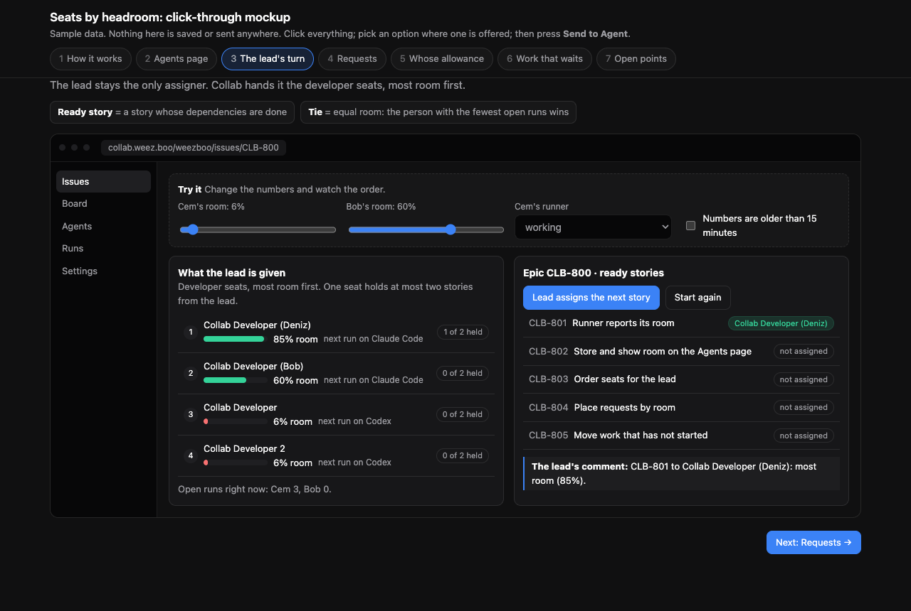
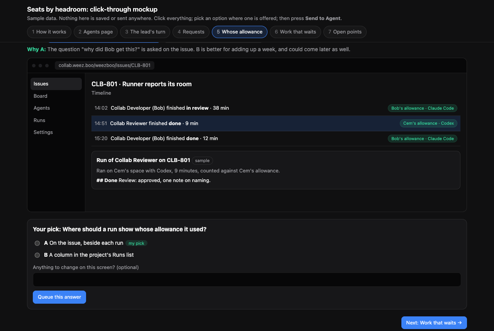

# Seats by room: the approved screens

The screens the owner approved on 19 November 2026 for the epic CLB-773, "Seats by room: work goes to the seat with allowance left". Build to these. Where a story and a screen disagree, ask before building.

All names and numbers in the pictures are sample data. `mockup.html` in this folder is the clickable page the pictures were taken from; open it in a browser to try each control. Its layout switches, its "Your pick" forms and its last tab ("Open points") are left from the review; what was picked is written on this page.

## What "room" is

One figure per seat: the percent of allowance left, against the runner's hold-back, on the program that seat would run next. It is shown as room left ("60% room"), never as percent used.

| Shown as | When |
| --- | --- |
| A bar and "60% room · next run on Claude Code" | The runner reported a figure in the last 15 minutes |
| "no room" with the reason | No runner is connected, the runner is offline, paused, has a full disk, or the allowance is used up |
| "unknown" with the reason | No figure, or one older than 15 minutes. Work is then placed as it was before this epic |

## How it works

Each runner reports room to Collab. Collab hands the lead the developer seats with the most room first, and places review, security and release requests itself by the same rule.

## Agents page (CLB-775, CLB-776)

Approved layout: **grouped by person**. One card per person with the runner's name, one room bar and that person's seats as role chips. The default seat of a role is marked.

The screenshot below shows the switch after the owner has enabled it.

The owner's switch "Members may add their own seats to this project" is off by default. After the owner enables it, a member without seats sees one button:

Pressing it creates a developer, a reviewer and a security seat named like "Collab Developer (Deniz)". The member can remove their own seats.

Who sees the numbers: the workspace owner and the lead see everyone's; a member sees their own.

## The lead's turn (CLB-777)

The lead stays the only assigner. It is given the developer seats ordered by room; equal room goes to the person with the fewest open runs; a seat with no room gets nothing. The lead's comment says why a seat was chosen.

The "Try it" box belongs to the mockup, not to the product.

## Requests (CLB-778)

Collab places a request on the seat of the role with the most room and says which seat got it and why. When no seat of the role has a fresh figure with room, it goes to the default seat, as before, unless Collab knows the default seat cannot start (no runner is connected, or its runner is offline, paused or full): then it goes to the next seat whose figure is unknown. When every seat of the role is known to have no room, it waits at the default seat.

## Whose allowance (CLB-779)

Approved layout: **on the issue, beside each run**. A chip names the owner and the program. Every project member sees it; no percentage is shown here.

## When a runner is full (CLB-780)

For the current rules on moving work, see [Started work](/docs/agents/seats#started-work) and [When a seat has had no room for 10 minutes](/docs/agents/seats#when-a-seat-has-had-no-room-for-10-minutes).

## Decided and left out

- A seat keeps one owner and one runner. No seat is shared between runners.
- One lead per project.
- Not in this version: a per-person reserve, a rule that keeps a person's reviewer seat away from that person's own work, and a Runs list with an allowance column.
