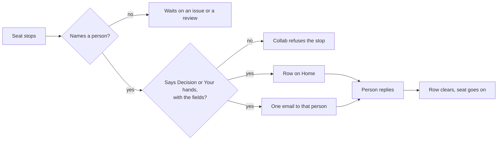

# Stops that need a person

Design note. The repository's owner asked for it on 25 November 2026 and is the person waiting for it. Nothing here is built yet.

## The problem

When a seat finishes a run naming a person, its exit note can describe either a choice or work the person must do. Home shows “Question” when it can identify reply words and where to send them. Otherwise it shows “Waiting on you”, even when the finish names a pull request. A person reading the row still has to work out which kind of help the seat needs, and the finish sends them no notification.

Measured on 25 November 2026:

| What | Number |
| --- | --- |
| A green pull request with a database migration waited for the person who merges it | 28 hours |
| Rows under "Needs you" on the owner's Home, all labelled "Question" | 25 |
| Of the 20 oldest, rows that ask the owner for something still open | 5 |
| Rows that name another person | 10 |
| Rows already answered or overtaken | 4, and 3 more partly |
| Rows that only ask to continue work already agreed, or report that a runner gave up | 2 |
| Decisions with no reply words | 3 |

One answer had been given on another issue the same day, and its row stayed for six days.

## The three lines

- **Who is waiting:** the repository's owner.
- **First day:** he opens Home and every row addressed to him is a real decision or a task for his hands, and a new one reaches him by email within a minute.
- **Smallest version:** a seat that names a person says which of two kinds of stop it is and gives the fields below; Collab refuses the stop otherwise. Then the Continue button, then the email.

## What exists today

Checked against commit `4f9347ac` of `main`.

- A successful named-person finish saves the full exit note on the run. Its `AGENT_RUN_FINISHED` activity records `runId`, `askedUser`, the one-line `nextStep` and, if supplied, `pullRequest` and `headCommit` together. A missing required heading or finish fact gives `exit_note_required`. A missing required wait target gives `exit_state_required` (`src/lib/agent-runs.ts`).
- Home matches the finish activity to the run by `runId` and reads `askedUser`, `pullRequest` and `nextStep` (`src/lib/dashboard/needs-you.ts`). A named-person stop with a pull request counts under “Reviews”, and one without counts under “From seats”. In either filter the row shows “Question” when Home finds reply words for the current issue or for a single, readable reply destination. Missing reply words or an unresolved destination give it the label “Waiting on you”. “All work” includes stops on readable issues even when they name someone else. Home counts all eligible rows, then sorts and displays at most 20 for the selected filter.
- A notification in the bell is written only when a seat asks a question in the middle of a run (`ISSUE_RUN_QUESTION`). A run that ends naming a person writes none.
- `sendEmail` in `src/lib/email.ts` is used for workspace invitations and nothing else. `NotificationPreferences` has `emailNotificationsEnabled`.
- The app has no job that runs at a time of day.
- The seat texts tell a seat how to ask a person (`askingAPerson` in `src/lib/agent-role-catalogue.ts`). Nothing checks that it did.
- CLB-1034 (pull request #798, merged on 25 November 2026) reads the question, the reply words and the suggested answer out of the seat's last comment. It names this note's first slice as "the proper fix … planned as the work after this".

## Decisions

The owner decided these on 25 November 2026.

1. **A seat declares the kind of stop.** A finish that names a person carries `ask`, one of two kinds:

   | Kind | The seat gives | Home shows |
   | --- | --- | --- |
   | Decision | one or more questions, each with two to four reply words and the one it suggests | "Question". With one question: a button per reply word for that finish, the suggested one first. With several: the questions, and a link to the issue |
   | Your hands | what to do in steps, and the reply word that says it is done | "Waiting on you", the steps, the reply word |

   A finish that names a person without `ask`, or with a Decision that has no reply words, is refused like a missing heading, and the refusal names what is missing.

   The reply belongs on the issue that stopped. A stop names no other issue for it: a seat that needs an answer about another issue asks on its own. A planner that asks several questions in one round gives them as several questions of one Decision.
2. **A status note or a wait on something else names no person.** A seat waiting on a request it filed with the review seat finishes `in_review` with `reviewRequest` naming that open request for this issue. A seat waiting on a blocker, including a security request, finishes `blocked` with `blockedBy` naming the open issue linked as blocking its work. A lead waiting for an unfinished child may finish `blocked` without naming a target. These waits create no named-person row on Home.
3. **"Shall I continue?" is not a stop.** The seat texts say: work that is already agreed goes on without asking. A real go or no-go is a Decision with `go` and `hold`. Collab can check the shape of a stop, not whether the decision is a real one, so this rule lives in the seat texts.
4. **Rows clear as they do today, and that is also what wakes the seat.** A row goes when anyone other than the seat comments on the issue after the stop, or when the issue is done. The same comment brings the issue back to its seat, so a cleared row never leaves a seat waiting. A merged pull request clears nothing by itself: a finish does not record which forge a pull request belongs to.
   Every Home button that posts a comment sends the issue and the displayed finish's `runId`. The server posts only if that run is still the issue's current unanswered stop, checking this and writing the comment atomically. If someone already answered, the issue is done or a later run has started, a click on the old row posts nothing.
5. **A Continue button** is bound to the displayed finish the same way as "Send answer". Choosing a reply word only fills the answer field, as today; nothing is posted until "Send answer" or Continue is pressed. Continue posts a comment on the issue under the name of whoever presses it, which brings the issue back to its seat as any comment does. Anyone who may comment on the issue may press it, on a row that names someone else too. It is for rows written before this work, and for a seat that stopped although it could have gone on.
6. **Email, after the Continue button.** A declared stop triggers one email to the person it names. At 09:00 London time, anyone with eligible open stops gets one list covering all of them, including those outside Home's first 20 rows. In both emails each stop gives the time it began and links directly to the readable issue where the person should reply. A Decision gives the question, reply words and suggested choice. Your hands gives the steps and the word to send once the work is done. No email for due dates. Before each email, at the moment of sending, Collab checks that the person is still a member of the workspace who may read the issue, and has not switched `emailNotificationsEnabled` off for that workspace. Someone who lost access since the stop gets nothing.
7. **Email goes only to the person named.** The "All work" view may keep listing other people's rows; nobody is emailed about them.
8. **Migration merges stay with a person** in the projects that have that rule. The email is what removes the wait.
9. **The refusal is switched on last, in a release of its own.** Slice 1 ships the check behind one setting of the deployment, off. Until it is on, a finish without `ask` is accepted and shown as today. It is switched on once the seat texts and the CLI send `ask` and Home has shown no finish without it for a week; a runner that finishes over HTTP without the CLI must send `ask` by then too. Switched on earlier, it would refuse every seat that names a person. There is no setting per workspace.
10. **An answer given before the finish counts.** A seat writes its question as a comment and finishes a moment later. A comment by anyone other than the seat that is later than the seat's last comment of that run answers the stop, also when it arrived before the finish: Home shows no row, no email is sent, and the issue goes straight back to the seat. Today both Home and the seat's inbox look only at comments later than the finish, so such an answer is lost and the seat waits.

## The cut

One slice at a time. The next starts when the one before is live and used once.

| Slice | What | Needs |
| --- | --- | --- |
| 1 | Add `ask` to named-person finishes, the refusal behind its switch, and the CLI options. Update the seat texts with the two stop kinds and the existing waits from decision 2 (`in_review` with `reviewRequest`, `blocked` with `blockedBy`, and the lead's child exception). Home reads the fields and posts reply words only for the displayed open stop (decisions 1 to 4, 9 and 10). | CLB-1034, merged on 25 November 2026; a CLI release |
| 2 | The Continue button uses slice 1's check for the displayed stop, including on legacy rows (decision 5) | slice 1 |
| 3 | Email the named person the choice or steps and the direct issue link (decisions 6 and 7) | slice 2; the mail key set in production |
| 4 | Select every eligible open stop for the person before Home's 20-row limit. Send the 09:00 list with the same details and issue links as slice 3. | slice 3. This slice also builds the job that runs at 09:00 London time; the app has none |

## Not in this work

- Slack or browser push.
- Rewriting the rows that exist today. Their finishes already have a `runId`. Anyone who may comment on the issue can clear a still-open legacy row with Continue or an answer.
- Showing a runner that gave up as a failed run. The runner records that only on its own side, so it needs a new report from the runner to the server.
- A reply that belongs on another issue than the one that stopped.
- A model that guesses the kind of a stop from its text.
- Any change to who merges what.
- A switch per workspace for the refusal.

## Not checked

- Whether the mail key is set in production.
- How many of the five newest rows on Home need a person; the page shows 20.
- The ages above were estimated from comment times. The run API returns the exact `endedAt` to the account that holds the run. Home uses it as the stop's `since` and shows the UTC timestamp when the reader hovers over the age.
